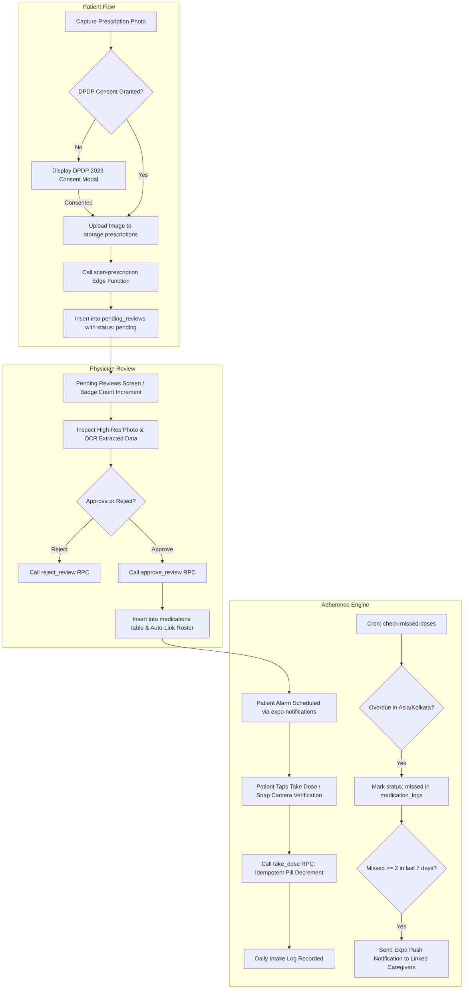

# MedSync Master Architecture & Reconstruction Blueprint

---

## 1. Executive Summary & Tech Stack

### High-Level Overview
**MedSync** is an offline-first, senior-accessible medication adherence, caregiver telemetry, and physician-supervised prescription verification mobile application. 
- **Core Purpose**: Eliminate senior medication errors, accidental double-dosing, and unmonitored lapses by providing a frictionless, high-contrast mobile client connected in real-time to family caregivers and licensed physicians.
- **Target Audience**:
  1. *Elderly Patients / Chronic Care Patients*: Requires high contrast, WCAG AAA accessibility, voice audio prompts, large tap targets (minimum 48dp), and camera-assisted intake verification.
  2. *Family Caregivers*: Requires real-time surveillance of patient adherence, instant alerts on missed doses, and zero-trust pairing with dependent family members.
  3. *Physicians / Clinicians*: Requires a clinical dashboard to review AI-parsed prescription slips, verify dosages, and formally approve routines before they activate on patient devices.
- **Primary Problem Solved**: Closes the dangerous gap between paper prescriptions and daily patient compliance. Patients no longer manually transcribe complex drug schedules; an AI vision pipeline scans prescription slips, queues them for doctor sign-off, and schedules native device alarms. Automated background telemetry alerts caregivers if doses are repeatedly missed.

### Full Architecture Pattern
- **Client Architecture**: **Layered Hexagonal / Clean Architecture** on **React Native (v0.86.3) / Expo SDK 57 (v57.0.30)** utilizing **Expo Router v4** file-based navigation.
  - **Presentation Layer**: Atomic UI components (`SeniorButton`, `PulseView`, `MedSyncLogo`, `ScreenHeader`), Screen Controllers, Context Providers (`AuthContext`, `AccessibilityContext`), and Custom Lifecycle Hooks (`useMedications`, `useCaregiverRoster`, `usePrescriptionReview`).
  - **Service Layer**: Pure Domain Services (`authService`, `medicationService`, `patientService`, `prescriptionService`, `notificationService`) conforming to a monadic `Result<T, E>` contract pattern.
  - **Data/Infrastructure Layer**: Supabase Client with a custom **Encrypted SecureStore Chunking Adapter** (overcoming Android's 2048-byte Keystore limit), PostgreSQL 15/16 with Row-Level Security (RLS), and Deno-based Serverless Edge Functions.
- **Backend Architecture**: **BaaS + Serverless Edge Architecture**:
  - PostgreSQL with Row-Level Security (RLS) guaranteeing tenant isolation.
  - Transactional stored procedures (`plpgsql`) executing atomic operations (idempotent pill counter decrements, cryptographic pairing code generation/claiming, clinical approvals).
  - Serverless Deno Edge Functions handling OpenAI GPT-4o Vision OCR and automated cron-based adherence surveillance.
- **Security & Compliance Standard**: Full adherence to India's **Digital Personal Data Protection (DPDP) Act 2023**, strict database-level role isolation, cryptographic zero-enumeration pairing, and server-side quota enforcement.

### Complete Technology Matrix

| Layer | Technology | Exact Version | Rationale & Selection Criteria |
|---|---|---|---|
| **Runtime & Language** | Node.js / TypeScript | Node v20+, TypeScript `~6.0.3` | Type-safe end-to-end contract between database, services, and UI components. |
| **Mobile Core Framework** | Expo / React Native | Expo `~57.0.30`, RN `0.86.3`, React `19.2.3` | Expo SDK 57 provides zero-configuration Hermes engine, modern architecture support, and reliable native module compilation. |
| **Routing & Navigation** | Expo Router | `~57.0.28` | File-system-based, deeply typed routing with nested role layouts and deep-linking capabilities. |
| **State Management** | React Context + Custom Hooks | React Core 19 | Lightweight, zero-boilerplate global state without heavy external state libraries; combined with optimistic UI state in custom hooks. |
| **Data Fetching / Client** | `@supabase/supabase-js` | `^2.112.4` | Direct WebSocket Realtime subscriptions, PostgreSQL connection pooling, and built-in Auth state handling. |
| **Hardware & Platform APIs** | `expo-notifications`, `expo-speech`, `expo-haptics`, `expo-image-picker`, `expo-secure-store`, `expo-print`, `expo-sharing` | SDK 57 compatible releases (`~57.0.x`) | Direct access to camera, microphone, text-to-speech engine, vibration motors, encrypted keychains, and print subsystem. |
| **UI & Styling** | Vanilla React Native `StyleSheet` + Tokenized Design System | Built-in | Avoids Tailwind compilation overhead and third-party styling bugs in React Native 0.86; guarantees deterministic rendering on low-end Android hardware. |
| **Backend & Database** | Supabase Managed PostgreSQL | PostgreSQL 15.6+ | Relational data integrity, ACID transactions, atomic RPC functions (`plpgsql`), Row Level Security, and Realtime pub/sub. |
| **Serverless Functions** | Deno Edge Runtime | Deno 1.40+ | Low-latency edge execution for AI OCR vision parsing and automated cron adherence checks. |
| **Testing Engine** | Native Node.js Test Runner | `node:test` + `node:assert` (Node 20+) | Zero-dependency, sub-second test execution (33 unit/integration tests running in under 300ms without Jest/Babel overhead). |

---

## 2. Directory Tree & File Importance Matrix

### Complete ASCII Repository Tree
```text
medsync-app/
├── .env.example
├── AGENTS.md
├── app.json
├── eas.json
├── package.json
├── tsconfig.json
├── assets/
│   ├── icon.png
│   ├── splash.png
│   └── images/
│       └── logo-transparent.png
├── scripts/
│   ├── clear_all_user_data.sql
│   ├── create_test2_user.sql
│   ├── patch-expo-notifications.js
│   ├── reset-project.js
│   ├── seed_demo_accounts.sql
│   └── seed_pilot_data.sql
├── src/
│   ├── global.css
│   ├── app/
│   │   ├── _layout.tsx
│   │   ├── index.tsx
│   │   ├── login.tsx
│   │   ├── forgot-password.tsx
│   │   ├── reset-password.tsx
│   │   ├── role-selection.tsx
│   │   ├── profile-setup.tsx
│   │   ├── edit-profile.tsx
│   │   ├── settings.tsx
│   │   ├── doctor-settings.tsx
│   │   ├── doctor-verification.tsx
│   │   ├── doctor-link.tsx
│   │   ├── medication-details.tsx
│   │   ├── medication-history.tsx
│   │   ├── patient-details.tsx
│   │   ├── patient-directory.tsx
│   │   ├── paused-medications.tsx
│   │   ├── pending-reviews.tsx
│   │   ├── review-details.tsx
│   │   ├── privacy-policy.tsx
│   │   ├── clinical-privacy-policy.tsx
│   │   └── (tabs)/
│   │       ├── _layout.tsx
│   │       ├── index.tsx
│   │       ├── patient-dashboard.tsx
│   │       ├── caregiver-dashboard.tsx
│   │       └── uploads.tsx
│   ├── components/
│   │   ├── AnimatedSplashScreen.tsx
│   │   ├── BackButton.tsx
│   │   ├── ErrorBoundary.tsx
│   │   ├── ExitConfirmationModal.tsx
│   │   ├── MedSyncLogo.tsx
│   │   ├── PulseView.tsx
│   │   ├── ScreenHeader.tsx
│   │   ├── SeniorButton.tsx
│   │   └── index.ts
│   ├── config/
│   │   └── env.ts
│   ├── constants/
│   │   └── dummyData.ts
│   ├── context/
│   │   ├── AccessibilityContext.tsx
│   │   ├── authcontext.tsx
│   │   └── index.ts
│   ├── hooks/
│   │   ├── index.ts
│   │   ├── useCaregiverRoster.ts
│   │   ├── useMedications.ts
│   │   └── usePrescriptionReview.ts
│   ├── lib/
│   │   ├── crashReporter.ts
│   │   └── supabase.ts
│   ├── services/
│   │   ├── apiClient.ts
│   │   ├── authService.ts
│   │   ├── index.ts
│   │   ├── medicationService.ts
│   │   ├── notificationService.ts
│   │   ├── patientService.ts
│   │   └── prescriptionService.ts
│   ├── theme/
│   │   └── index.ts
│   ├── types/
│   │   ├── api.ts
│   │   ├── auth.ts
│   │   ├── index.ts
│   │   ├── medication.ts
│   │   ├── patient.ts
│   │   └── review.ts
│   └── utils/
│       ├── avatarHelper.ts
│       ├── errorHandler.ts
│       ├── index.ts
│       ├── prescriptionHelper.ts
│       └── timeUtils.ts
├── supabase/
│   ├── functions/
│   │   ├── deno.json
│   │   ├── deno.lock
│   │   ├── import_map.json
│   │   ├── check-missed-doses/
│   │   │   └── index.ts
│   │   └── scan-prescription/
│   │       └── index.ts
│   └── migrations/
│       ├── 20261015_security_and_integrity.sql
│       ├── 20261016_automated_missed_doses.sql
│       ├── 20261016_camera_verification.sql
│       ├── 20261016_delete_all_user_data.sql
│       ├── 20261016_deprecate_legacy_patients.sql
│       ├── 20261017_fix_profile_rls_and_auth_trigger.sql
│       ├── 20261017_security_and_compliance_hardening.sql
│       ├── 20261018_consolidated_database_schema.sql
│       └── 20261018_doctor_credential_verification.sql
└── tests/
    ├── architecture_and_services.test.js
    └── security_and_integrity.test.js
```

### File Importance Ledger

| File Path | Criticality | Core Purpose & Key Exports | Dependencies / Key Importers |
|---|---|---|---|
| `src/lib/supabase.ts` | **P0** | Exports configured `supabase` client with custom `EncryptedSecureStoreAdapter` chunking large JWTs to bypass Android 2048-byte limit. | Depends on `expo-secure-store`, `env.ts`. Imported across all services and contexts. |
| `src/context/authcontext.tsx` | **P0** | Root authentication state machine. Manages session, active profile, persona switcher, and sign-out. | Depends on `supabase.ts`, `authService.ts`. Imported by `_layout.tsx`, navigation screens. |
| `src/services/apiClient.ts` | **P0** | Defines monadic `Result<T, E>` pattern (`ok`, `err`) and centralized database exception normalization. | Used by all domain services (`medicationService`, `patientService`, etc.). |
| `src/services/medicationService.ts` | **P0** | CRUD for patient medication schedule and atomic intake execution via `take_dose` RPC. | Used by `useMedications.ts`, `medication-details.tsx`. |
| `src/services/prescriptionService.ts` | **P0** | Manages prescription storage uploads, OCR edge function invocation, and triage reviews. | Used by `uploads.tsx`, `pending-reviews.tsx`, `review-details.tsx`. |
| `src/services/patientService.ts` | **P0** | Pairing code generation/redemption, roster management, alert overrides, and PDF export. | Used by `useCaregiverRoster.ts`, `caregiver-dashboard.tsx`. |
| `src/app/_layout.tsx` | **P0** | Root application controller. Mounts providers, handles auth state routing guards, and registers push notifications. | Root router; mounts all navigation stacks. |
| `src/app/(tabs)/_layout.tsx` | **P0** | Tab navigation layout dynamically altering tab bars based on user role (Patient vs Caregiver/Doctor). | Injected by Expo Router inside `src/app`. |
| `src/app/(tabs)/patient-dashboard.tsx` | **P0** | Senior-friendly daily medication view, camera verification modal, pill counters, and adherence progress. | Tab entry for patients; imports `useMedications`, `SeniorButton`. |
| `src/app/(tabs)/caregiver-dashboard.tsx` | **P0** | Caregiver command center showing monitored patients, active alert warnings, pending prescription review queue. | Tab entry for caregivers/doctors; imports `useCaregiverRoster`. |
| `src/app/review-details.tsx` | **P0** | Physician verification screen for prescription OCR approvals, dosage tuning, and photo zoom inspection. | Route pushed from review queues; calls `approve_review` / `reject_review`. |
| `supabase/migrations/20261018_consolidated_database_schema.sql` | **P0** | Master self-contained SQL DDL defining all tables, triggers, RLS policies, RPCs, and Realtime publications. | Applied to Supabase PostgreSQL database. |
| `supabase/functions/check-missed-doses/index.ts` | **P0** | Serverless adherence watchdog evaluating missed doses in IST timezone and dispatching push notifications. | Scheduled via Supabase pg_cron. |
| `supabase/functions/scan-prescription/index.ts` | **P0** | OpenAI Vision GPT-4o OCR edge function extracting medicine name, dosage, and duration with daily quotas. | Invoked by `prescriptionService.uploadAndSubmitPrescription`. |
| `src/context/AccessibilityContext.tsx` | **P1** | Global accessibility settings: High contrast mode, text scaling, speech synthesis, haptics. | Imported across all presentation components. |
| `src/hooks/useMedications.ts` | **P1** | Reactive state hook subscribing to `medications` and `medication_logs` tables in realtime. | Consumed by `patient-dashboard.tsx`. |
| `src/hooks/useCaregiverRoster.ts` | **P1** | Reactive state hook subscribing to `patient_caregivers` and patient adherence alerts. | Consumed by `caregiver-dashboard.tsx`. |
| `src/components/SeniorButton.tsx` | **P1** | Accessible high-contrast button exceeding WCAG AAA standards with built-in haptics and audio feedback. | Used across all screens for primary actions. |
| `src/utils/prescriptionHelper.ts` | **P1** | Resilient prescription image URL resolver handling relative paths, signed URLs, and public bucket CDN URLs. | Consumed by `review-details.tsx`, `caregiver-dashboard.tsx`, `pending-reviews.tsx`. |
| `src/utils/timeUtils.ts` | **P1** | 12-hour AM/PM time parsing, minute offset calculation, and day-quadrant slot classification. | Consumed by medication scheduling engine. |
| `src/config/env.ts` | **P2** | Environment variable accessor with type validation and fallback constants. | Consumed by `supabase.ts`, `apiClient.ts`. |
| `src/theme/index.ts` | **P2** | Centralized design tokens: color palette, shadows, typography, spacing, border radiuses. | Injected into all `StyleSheet.create` blocks. |
| `tests/architecture_and_services.test.js` | **P2** | Test suite validating `Result<T>` pattern, time parsing, error normalization, and pairing codes. | Executed via `npm test`. |
| `tests/security_and_integrity.test.js` | **P2** | Test suite validating HTML sanitization, SecureStore chunking, quota enforcement, and intake idempotence. | Executed via `npm test`. |

---

## 3. Dependencies & Runtime Environment

### Package Manifest Breakdown (`package.json`)
```json
{
  "name": "medsync-app",
  "main": "expo-router/entry",
  "version": "1.0.0",
  "dependencies": {
    "@expo/ui": "~57.0.25",
    "@expo/vector-icons": "^15.0.2",
    "@react-native-async-storage/async-storage": "2.2.0",
    "@react-navigation/native": "^7.3.18",
    "@react-navigation/native-stack": "^7.18.10",
    "@supabase/supabase-js": "^2.112.4",
    "base64-arraybuffer": "^1.0.2",
    "expo": "~57.0.30",
    "expo-application": "~57.0.3",
    "expo-constants": "~57.0.16",
    "expo-dev-client": "~57.0.20",
    "expo-device": "~57.0.2",
    "expo-file-system": "~57.0.6",
    "expo-font": "~57.0.2",
    "expo-glass-effect": "~57.0.4",
    "expo-haptics": "~57.0.3",
    "expo-image": "~57.0.5",
    "expo-image-picker": "~57.0.20",
    "expo-intent-launcher": "~57.0.1",
    "expo-linking": "~57.0.13",
    "expo-notifications": "~57.0.23",
    "expo-print": "~57.0.2",
    "expo-router": "~57.0.28",
    "expo-secure-store": "~57.0.4",
    "expo-sharing": "~57.0.23",
    "expo-speech": "~57.0.3",
    "expo-splash-screen": "~57.0.10",
    "expo-status-bar": "~57.0.1",
    "expo-symbols": "~57.0.3",
    "expo-system-ui": "~57.0.4",
    "expo-web-browser": "~57.0.3",
    "react": "19.2.3",
    "react-dom": "19.2.3",
    "react-native": "0.86.3",
    "react-native-gesture-handler": "~2.32.0",
    "react-native-reanimated": "4.5.1",
    "react-native-safe-area-context": "~5.7.0",
    "react-native-screens": "~4.26.0",
    "react-native-svg": "15.15.4",
    "react-native-url-polyfill": "^4.0.0",
    "react-native-web": "~0.21.0",
    "react-native-worklets": "0.10.1"
  },
  "devDependencies": {
    "@types/react": "~19.2.2",
    "typescript": "~6.0.3"
  },
  "scripts": {
    "start": "expo start",
    "reset-project": "node ./scripts/reset-project.js",
    "android": "expo run:android",
    "ios": "expo run:ios",
    "web": "expo start --web",
    "lint": "expo lint",
    "test": "node --test tests/*.test.js"
  }
}
```

### Environment Variables Specification

| Key | Sensitivity | Format / Example | Default / Fallback | Purpose |
|---|---|---|---|---|
| `EXPO_PUBLIC_SUPABASE_URL` | Public | `https://[id].supabase.co` | Embedded fallback in `env.ts` | URL endpoint for Supabase REST & WebSocket gateway. |
| `EXPO_PUBLIC_SUPABASE_ANON_KEY` | Public | `eyJhbGci...` | Embedded fallback in `env.ts` | Publishable key adhering to RLS policies. |
| `EXPO_PUBLIC_EAS_PROJECT_ID` | Public | UUID (`08976e05-...`) | `undefined` | Expo Application Services Project identifier. |
| `EXPO_PUBLIC_SENTRY_DSN` | Public | `https://[key]@sentry.io/[id]` | `undefined` | Error monitoring & crash reporting telemetry. |
| `OPENAI_API_KEY` | **Secret (Server Only)** | `sk-proj-...` | None (Edge function throws 503) | Used exclusively inside Deno `scan-prescription` edge function for GPT-4o OCR. |
| `SUPABASE_SERVICE_ROLE_KEY` | **Secret (Server Only)** | `eyJhbGci...` | None (Edge function throws 401) | Used by `check-missed-doses` cron to bypass RLS and query all overdue doses. |

---

## 4. Data Layer & Database Architecture

### Complete Relational Schema Definition (PostgreSQL DDL)

```sql
-- Enable necessary extensions
CREATE EXTENSION IF NOT EXISTS "uuid-ossp";
CREATE EXTENSION IF NOT EXISTS "pgcrypto";

-- =============================================================================
-- 1. PROFILES TABLE (Core User Entity)
-- =============================================================================
CREATE TABLE public.profiles (
    id UUID PRIMARY KEY REFERENCES auth.users(id) ON DELETE CASCADE,
    full_name TEXT NOT NULL,
    role TEXT NOT NULL CHECK (role IN ('patient', 'caregiver', 'doctor')),
    age INTEGER CHECK (age >= 0 AND age <= 130),
    blood_group TEXT CHECK (blood_group IN ('A+', 'A-', 'B+', 'B-', 'AB+', 'AB-', 'O+', 'O-', 'Others')),
    allergies TEXT,
    avatar_url TEXT,
    alerts_enabled BOOLEAN DEFAULT true NOT NULL,
    push_token TEXT,
    is_verified_doctor BOOLEAN DEFAULT false NOT NULL,
    medical_license_number TEXT,
    medical_council TEXT,
    specialty TEXT,
    clinic_affiliation TEXT,
    years_of_experience TEXT,
    created_at TIMESTAMPTZ DEFAULT now() NOT NULL,
    updated_at TIMESTAMPTZ DEFAULT now() NOT NULL
);

CREATE INDEX idx_profiles_role ON public.profiles(role);
CREATE INDEX idx_profiles_license ON public.profiles(medical_license_number) WHERE is_verified_doctor = true;

-- =============================================================================
-- 2. MEDICATIONS TABLE (Active & Paused Prescriptions)
-- =============================================================================
CREATE TABLE public.medications (
    id BIGINT GENERATED BY DEFAULT AS IDENTITY PRIMARY KEY,
    patient_id UUID NOT NULL REFERENCES public.profiles(id) ON DELETE CASCADE,
    medicine_name TEXT NOT NULL,
    dosage TEXT NOT NULL,
    time TEXT NOT NULL, -- Format: '08:00 AM'
    status TEXT DEFAULT 'pending' NOT NULL CHECK (status IN ('pending', 'taken', 'missed')),
    duration TEXT,
    description TEXT,
    pills_remaining INTEGER DEFAULT 30 NOT NULL CHECK (pills_remaining >= 0),
    total_pills INTEGER DEFAULT 30 NOT NULL CHECK (total_pills >= 0),
    is_active BOOLEAN DEFAULT true NOT NULL,
    created_at TIMESTAMPTZ DEFAULT now() NOT NULL,
    updated_at TIMESTAMPTZ DEFAULT now() NOT NULL
);

CREATE INDEX idx_medications_patient_active ON public.medications(patient_id, is_active);

-- =============================================================================
-- 3. MEDICATION_LOGS TABLE (Daily Dose Adherence Journal)
-- =============================================================================
CREATE TABLE public.medication_logs (
    id BIGINT GENERATED BY DEFAULT AS IDENTITY PRIMARY KEY,
    medication_id BIGINT NOT NULL REFERENCES public.medications(id) ON DELETE CASCADE,
    patient_id UUID NOT NULL REFERENCES public.profiles(id) ON DELETE CASCADE,
    log_date DATE NOT NULL,
    scheduled_time TEXT NOT NULL,
    status TEXT DEFAULT 'taken' NOT NULL CHECK (status IN ('taken', 'missed', 'skipped')),
    camera_verified BOOLEAN DEFAULT false NOT NULL,
    created_at TIMESTAMPTZ DEFAULT now() NOT NULL,
    CONSTRAINT uq_medication_date UNIQUE (medication_id, log_date)
);

CREATE INDEX idx_medication_logs_lookup ON public.medication_logs(patient_id, log_date, status);

-- =============================================================================
-- 4. PATIENT_CAREGIVERS TABLE (Pairing Links & Roster)
-- =============================================================================
CREATE TABLE public.patient_caregivers (
    id BIGINT GENERATED BY DEFAULT AS IDENTITY PRIMARY KEY,
    patient_id UUID NOT NULL REFERENCES public.profiles(id) ON DELETE CASCADE,
    caregiver_id UUID REFERENCES public.profiles(id) ON DELETE SET NULL,
    pairing_code TEXT,
    status TEXT DEFAULT 'pending' NOT NULL CHECK (status IN ('pending', 'active', 'revoked')),
    override_alerts BOOLEAN DEFAULT false NOT NULL,
    created_at TIMESTAMPTZ DEFAULT now() NOT NULL,
    updated_at TIMESTAMPTZ DEFAULT now() NOT NULL,
    CONSTRAINT uq_patient_caregiver UNIQUE (patient_id, caregiver_id)
);

CREATE UNIQUE INDEX uq_open_pairing_code ON public.patient_caregivers(pairing_code) WHERE caregiver_id IS NULL;
CREATE INDEX idx_patient_caregivers_active ON public.patient_caregivers(caregiver_id, status);

-- =============================================================================
-- 5. PENDING_REVIEWS TABLE (Prescription OCR Triage Queue)
-- =============================================================================
CREATE TABLE public.pending_reviews (
    id BIGINT GENERATED BY DEFAULT AS IDENTITY PRIMARY KEY,
    patient_id UUID NOT NULL REFERENCES public.profiles(id) ON DELETE CASCADE,
    patient_name TEXT NOT NULL,
    image_url TEXT NOT NULL,
    medication TEXT,
    dosage TEXT,
    duration TEXT,
    doctor_notes TEXT,
    status TEXT DEFAULT 'pending' NOT NULL CHECK (status IN ('pending', 'approved', 'rejected')),
    target_doctor_id UUID REFERENCES public.profiles(id) ON DELETE SET NULL,
    time_ago TEXT,
    created_at TIMESTAMPTZ DEFAULT now() NOT NULL,
    updated_at TIMESTAMPTZ DEFAULT now() NOT NULL
);

CREATE INDEX idx_pending_reviews_queue ON public.pending_reviews(status, created_at DESC);
CREATE INDEX idx_pending_reviews_target ON public.pending_reviews(target_doctor_id, status);

-- =============================================================================
-- 6. USER_PUSH_TOKENS TABLE (Owner-Isolated Notifications Store)
-- =============================================================================
CREATE TABLE public.user_push_tokens (
    user_id UUID PRIMARY KEY REFERENCES public.profiles(id) ON DELETE CASCADE,
    push_token TEXT NOT NULL,
    updated_at TIMESTAMPTZ DEFAULT now() NOT NULL
);
```

### Storage Buckets & Policies
```sql
-- Ensure public prescriptions bucket exists
INSERT INTO storage.buckets (id, name, public)
VALUES ('prescriptions', 'prescriptions', true)
ON CONFLICT (id) DO UPDATE SET public = true;

-- Public can view prescription photos (allows doctors & patients to load images over HTTP)
DROP POLICY IF EXISTS "Public can view prescriptions" ON storage.objects;
CREATE POLICY "Public can view prescriptions" ON storage.objects
FOR SELECT TO public
USING (bucket_id = 'prescriptions');

-- Patients can only upload into their own folder: {user_id}/{filename}
DROP POLICY IF EXISTS "upload own folder" ON storage.objects;
CREATE POLICY "upload own folder" ON storage.objects
FOR INSERT TO authenticated
WITH CHECK (
    bucket_id = 'prescriptions' 
    AND (storage.foldername(name))[1] = auth.uid()::text
);
```

### Complete Stored Procedures & Triggers (`plpgsql`)

#### 1. Auto-Profile Trigger on Auth Signup
```sql
CREATE OR REPLACE FUNCTION public.handle_new_user()
RETURNS TRIGGER
LANGUAGE plpgsql
SECURITY DEFINER
SET search_path = public
AS $$
BEGIN
    INSERT INTO public.profiles (
        id,
        full_name,
        role,
        is_verified_doctor,
        alerts_enabled,
        created_at,
        updated_at
    )
    VALUES (
        NEW.id,
        COALESCE(NEW.raw_user_meta_data->>'full_name', split_part(NEW.email, '@', 1)),
        COALESCE(NEW.raw_user_meta_data->>'role', 'patient'),
        false,
        true,
        NOW(),
        NOW()
    )
    ON CONFLICT (id) DO UPDATE SET
        full_name = COALESCE(NULLIF(public.profiles.full_name, ''), EXCLUDED.full_name),
        role = COALESCE(public.profiles.role, EXCLUDED.role),
        updated_at = NOW();

    RETURN NEW;
END;
$$;

DROP TRIGGER IF EXISTS on_auth_user_created ON auth.users;
CREATE TRIGGER on_auth_user_created
AFTER INSERT ON auth.users
FOR EACH ROW EXECUTE FUNCTION public.handle_new_user();
```

#### 2. Profile Field Protection Trigger
```sql
CREATE OR REPLACE FUNCTION public.protect_profile_fields()
RETURNS TRIGGER
LANGUAGE plpgsql
AS $$
BEGIN
    IF current_user IN ('anon', 'authenticated') THEN
        NEW.id := OLD.id;
        NEW.role := OLD.role;
        NEW.is_verified_doctor := OLD.is_verified_doctor;
    END IF;
    NEW.updated_at := NOW();
    RETURN NEW;
END;
$$;

DROP TRIGGER IF EXISTS trg_protect_profile_fields ON public.profiles;
CREATE TRIGGER trg_protect_profile_fields
BEFORE UPDATE ON public.profiles
FOR EACH ROW EXECUTE FUNCTION public.protect_profile_fields();
```

#### 3. Atomic Dose Intake (`take_dose`)
```sql
CREATE OR REPLACE FUNCTION public.take_dose(
    p_medication_id bigint,
    p_scheduled_time text DEFAULT '00:00',
    p_camera_verified boolean DEFAULT false
)
RETURNS jsonb
LANGUAGE plpgsql
SECURITY DEFINER
SET search_path = public
AS $$
DECLARE
    v_patient_id uuid := auth.uid();
    v_today date := (now() AT TIME ZONE 'Asia/Kolkata')::date;
    v_new_pills int;
    v_med_name text;
    v_log_id bigint;
BEGIN
    SELECT medicine_name INTO v_med_name
    FROM medications
    WHERE id = p_medication_id AND patient_id = v_patient_id;

    IF NOT FOUND THEN
        RAISE EXCEPTION 'Medication not found or unauthorized';
    END IF;

    -- Upsert intake log only if not already taken today
    INSERT INTO medication_logs (
        medication_id, patient_id, log_date, scheduled_time, status, camera_verified
    ) VALUES (
        p_medication_id, v_patient_id, v_today, p_scheduled_time, 'taken', p_camera_verified
    )
    ON CONFLICT (medication_id, log_date)
    DO UPDATE SET status = 'taken', camera_verified = EXCLUDED.camera_verified
    WHERE medication_logs.status != 'taken'
    RETURNING id INTO v_log_id;

    -- Idempotence: If already taken earlier today, return early without double-decrementing
    IF v_log_id IS NULL THEN
        SELECT pills_remaining INTO v_new_pills FROM medications WHERE id = p_medication_id;
        RETURN jsonb_build_object(
            'success', true,
            'already_taken', true,
            'pills_remaining', COALESCE(v_new_pills, 0),
            'medicine_name', v_med_name,
            'camera_verified', p_camera_verified
        );
    END IF;

    -- Atomically decrement pills on initial take
    UPDATE medications
    SET pills_remaining = GREATEST(0, COALESCE(pills_remaining, 30) - 1)
    WHERE id = p_medication_id AND patient_id = v_patient_id
    RETURNING pills_remaining INTO v_new_pills;

    RETURN jsonb_build_object(
        'success', true,
        'already_taken', false,
        'pills_remaining', v_new_pills,
        'medicine_name', v_med_name,
        'camera_verified', p_camera_verified
    );
END;
$$;
GRANT EXECUTE ON FUNCTION public.take_dose(bigint, text, boolean) TO authenticated;
```

#### 4. Cryptographic Pairing Code Generator (`create_pairing_code`)
```sql
CREATE OR REPLACE FUNCTION public.create_pairing_code()
RETURNS jsonb
LANGUAGE plpgsql
SECURITY DEFINER
SET search_path = public
AS $$
DECLARE
    v_patient_id uuid := auth.uid();
    v_code text;
    v_chars text := 'ABCDEFGHJKLMNPQRSTUVWXYZ23456789'; -- Unambiguous characters
    v_bytes bytea;
    v_existing record;
BEGIN
    IF v_patient_id IS NULL THEN
        RAISE EXCEPTION 'Authentication required';
    END IF;

    -- Reuse existing unexpired code if generated within last 15 minutes
    SELECT pairing_code, created_at INTO v_existing
    FROM patient_caregivers
    WHERE patient_id = v_patient_id
      AND caregiver_id IS NULL
      AND created_at > (now() - interval '15 minutes')
    ORDER BY created_at DESC
    LIMIT 1;

    IF v_existing.pairing_code IS NOT NULL THEN
        RETURN jsonb_build_object('success', true, 'pairing_code', v_existing.pairing_code);
    END IF;

    -- Generate random 8-character cryptographic uppercase code
    v_bytes := gen_random_bytes(8);
    v_code := '';
    FOR i IN 0..7 LOOP
        v_code := v_code || substr(v_chars, (get_byte(v_bytes, i) % length(v_chars)) + 1, 1);
    END LOOP;

    INSERT INTO patient_caregivers (patient_id, pairing_code, status)
    VALUES (v_patient_id, v_code, 'pending');

    RETURN jsonb_build_object('success', true, 'pairing_code', v_code);
END;
$$;
GRANT EXECUTE ON FUNCTION public.create_pairing_code() TO authenticated;
```

#### 5. Secure Pairing Code Claim (`claim_pairing_code`)
```sql
CREATE OR REPLACE FUNCTION public.claim_pairing_code(p_code text)
RETURNS jsonb
LANGUAGE plpgsql
SECURITY DEFINER
SET search_path = public
AS $$
DECLARE
    v_caller_id uuid := auth.uid();
    v_caller_role text;
    v_record record;
BEGIN
    IF v_caller_id IS NULL THEN
        RAISE EXCEPTION 'Authentication required to claim pairing code';
    END IF;

    SELECT role INTO v_caller_role FROM profiles WHERE id = v_caller_id;
    IF v_caller_role IS NULL OR v_caller_role NOT IN ('caregiver', 'doctor') THEN
        RAISE EXCEPTION 'Only caregivers or doctors can claim pairing codes';
    END IF;

    -- Atomically claim unassigned code created within the last 15 minutes
    UPDATE patient_caregivers
    SET caregiver_id = v_caller_id, status = 'active', updated_at = NOW()
    WHERE pairing_code = upper(trim(p_code))
      AND caregiver_id IS NULL
      AND created_at > (now() - interval '15 minutes')
    RETURNING * INTO v_record;

    IF NOT FOUND THEN
        RAISE EXCEPTION 'Invalid, expired, or already claimed pairing code';
    END IF;

    RETURN jsonb_build_object(
        'success', true,
        'patient_id', v_record.patient_id,
        'message', 'Patient successfully linked'
    );
END;
$$;
GRANT EXECUTE ON FUNCTION public.claim_pairing_code(text) TO authenticated;
```

#### 6. Scoped Physician/Caregiver Approval of Prescription (`approve_review`)
```sql
CREATE OR REPLACE FUNCTION public.approve_review(
    p_review_id bigint,
    p_medicine_name text,
    p_dosage text,
    p_duration text,
    p_time text DEFAULT '08:00 AM',
    p_doctor_notes text DEFAULT NULL,
    p_pills_remaining int DEFAULT 30,
    p_total_pills int DEFAULT 30
)
RETURNS jsonb
LANGUAGE plpgsql
SECURITY DEFINER
SET search_path = public
AS $$
DECLARE
    v_caller_id uuid := auth.uid();
    v_caller_profile record;
    v_review record;
    v_med_id bigint;
    v_remaining int := COALESCE(p_pills_remaining, 30);
    v_total int := COALESCE(p_total_pills, 30);
BEGIN
    IF v_caller_id IS NULL THEN
        RAISE EXCEPTION 'Unauthorized: authentication required';
    END IF;

    -- Validate input ranges
    IF LENGTH(TRIM(COALESCE(p_medicine_name, ''))) = 0 OR LENGTH(p_medicine_name) > 200 THEN
        RAISE EXCEPTION 'Invalid medicine name: must be between 1 and 200 characters';
    END IF;
    IF v_remaining < 0 OR v_remaining > 5000 THEN
        RAISE EXCEPTION 'Invalid pill count: must be between 0 and 5000';
    END IF;

    -- Lock the row and verify pending status
    SELECT * INTO v_review 
    FROM pending_reviews 
    WHERE id = p_review_id AND status = 'pending' 
    FOR UPDATE;

    IF NOT FOUND THEN
        RAISE EXCEPTION 'Prescription review not found or already approved/rejected';
    END IF;

    -- Caller must be verified doctor OR active linked caregiver
    SELECT * INTO v_caller_profile FROM profiles WHERE id = v_caller_id;
    IF v_caller_profile IS NULL OR (
        v_caller_profile.is_verified_doctor IS NOT TRUE 
        AND NOT EXISTS (
            SELECT 1 FROM patient_caregivers
            WHERE patient_id = v_review.patient_id
              AND caregiver_id = v_caller_id
              AND status = 'active'
        )
    ) THEN
        RAISE EXCEPTION 'Only verified doctors or active linked caregivers can review prescriptions';
    END IF;

    -- If a specific target doctor was assigned, prevent unrelated doctors from approving
    IF v_review.target_doctor_id IS NOT NULL 
       AND v_review.target_doctor_id IS DISTINCT FROM v_caller_id
       AND NOT EXISTS (
           SELECT 1 FROM patient_caregivers
           WHERE patient_id = v_review.patient_id
             AND caregiver_id = v_caller_id
             AND status = 'active'
       ) THEN
        RAISE EXCEPTION 'Not your patient: prescription assigned to another physician';
    END IF;

    -- Update review status
    UPDATE pending_reviews
    SET status = 'approved',
        medication = p_medicine_name,
        dosage = p_dosage,
        duration = p_duration,
        doctor_notes = p_doctor_notes
    WHERE id = p_review_id;

    -- Insert confirmed medication into patient routine
    INSERT INTO medications (
        patient_id, medicine_name, dosage, time, status, duration,
        description, pills_remaining, total_pills, is_active
    ) VALUES (
        v_review.patient_id, p_medicine_name, p_dosage, COALESCE(p_time, '08:00 AM'),
        'pending', p_duration, 'Reviewed by ' || COALESCE(v_caller_profile.full_name, 'Practitioner'),
        v_remaining, v_total, true
    ) RETURNING id INTO v_med_id;

    RETURN jsonb_build_object(
        'success', true,
        'review_id', p_review_id,
        'medication_id', v_med_id,
        'patient_id', v_review.patient_id,
        'medicine_name', p_medicine_name,
        'pills_remaining', v_remaining,
        'total_pills', v_total
    );
END;
$$;
REVOKE EXECUTE ON FUNCTION public.approve_review(bigint, text, text, text, text, text, int, int) FROM PUBLIC, anon;
GRANT EXECUTE ON FUNCTION public.approve_review(bigint, text, text, text, text, text, int, int) TO authenticated;
```

#### 7. Scoped Physician/Caregiver Rejection of Prescription (`reject_review`)
```sql
CREATE OR REPLACE FUNCTION public.reject_review(
    p_review_id bigint,
    p_doctor_notes text DEFAULT NULL
)
RETURNS jsonb
LANGUAGE plpgsql
SECURITY DEFINER
SET search_path = public
AS $$
DECLARE
    v_caller_id uuid := auth.uid();
    v_caller_profile record;
    v_review record;
BEGIN
    IF v_caller_id IS NULL THEN
        RAISE EXCEPTION 'Unauthorized: authentication required';
    END IF;

    SELECT * INTO v_review 
    FROM pending_reviews 
    WHERE id = p_review_id AND status = 'pending' 
    FOR UPDATE;

    IF NOT FOUND THEN
        RAISE EXCEPTION 'Prescription review not found or already approved/rejected';
    END IF;

    -- Caller must be verified doctor OR active linked caregiver
    SELECT * INTO v_caller_profile FROM profiles WHERE id = v_caller_id;
    IF v_caller_profile IS NULL OR (
        v_caller_profile.is_verified_doctor IS NOT TRUE 
        AND NOT EXISTS (
            SELECT 1 FROM patient_caregivers
            WHERE patient_id = v_review.patient_id
              AND caregiver_id = v_caller_id
              AND status = 'active'
        )
    ) THEN
        RAISE EXCEPTION 'Only verified doctors or active linked caregivers can review prescriptions';
    END IF;

    IF v_review.target_doctor_id IS NOT NULL 
       AND v_review.target_doctor_id IS DISTINCT FROM v_caller_id
       AND NOT EXISTS (
           SELECT 1 FROM patient_caregivers
           WHERE patient_id = v_review.patient_id
             AND caregiver_id = v_caller_id
             AND status = 'active'
       ) THEN
        RAISE EXCEPTION 'Not your patient: prescription assigned to another physician';
    END IF;

    UPDATE pending_reviews
    SET status = 'rejected',
        doctor_notes = p_doctor_notes
    WHERE id = p_review_id;

    RETURN jsonb_build_object('success', true, 'review_id', p_review_id, 'status', 'rejected');
END;
$$;
REVOKE EXECUTE ON FUNCTION public.reject_review(bigint, text) FROM PUBLIC, anon;
GRANT EXECUTE ON FUNCTION public.reject_review(bigint, text) TO authenticated;
```

#### 8. Clinical Verification Governance (Manual Board Audit)
Verified physician status (`is_verified_doctor = true`) is protected by database triggers against direct client tampering (`protect_profile_fields`). Self-elevation functions have been eliminated. Credentials submitted by medical practitioners (`medical_license_number`, `medical_council`, `clinic_affiliation`) are audited against State Medical Council or National Medical Commission (NMC) registries before verification is granted via SQL Editor or clinical admin.
```sql
DROP FUNCTION IF EXISTS public.submit_doctor_verification(TEXT, TEXT, TEXT, TEXT);
```

---

## 5. System Logic, Data Flow & API Contracts

### 1. Authentication & Session Architecture
- **Supabase Auth Integration**: Email/Password authentication issuing standard OIDC JWT access and refresh tokens.
- **Android 2048-Byte Keystore Limit Solution**: Standard `expo-secure-store` throws an unhandled OS exception when storing strings exceeding 2048 bytes on Android devices. MedSync implements a chunking storage adapter in `src/lib/supabase.ts`:
  - Payload length > 1800 characters: Split into `N` slices stored as `${key}_0`, `${key}_1`, ..., `${key}_N-1`, and writes the count to `${key}_chunks`.
  - Reading reassembles all slices into a continuous token string.
- **Role Isolation & Guards**:
  - `patient`: Routed to `(tabs)/patient-dashboard`. No access to `(tabs)/caregiver-dashboard` or doctor verification screens.
  - `caregiver`: Routed to `(tabs)/caregiver-dashboard`. Can switch persona to patient for personal medications, claim patient pairing codes, view linked adherence.
  - `doctor`: Elevated caregiver with verified license credentials. Possesses full clinical sign-off capabilities for prescription triage queues.

### 2. Core Business Pipelines



### 3. API & Edge Function Catalog

#### `POST /functions/v1/scan-prescription`
- **Auth**: Authenticated JWT (`Authorization: Bearer <token>`).
- **Rate Limit**: Maximum 10 scans per user per calendar day (Asia/Kolkata timezone).
- **Size Limit**: Maximum 3MB image (~4.2MB base64).
- **Request Payload**:
  ```json
  {
    "base64Image": "/9j/4AAQSkZJRgABAQEASABIAAD..."
  }
  ```
- **Success Response (200 OK)**:
  ```json
  {
    "medicine_name": "Metformin 500mg",
    "dosage": "1 tablet twice daily after meals",
    "duration": "30 days"
  }
  ```
- **Error Response (429 Too Many Requests)**:
  ```json
  {
    "error": "Daily prescription scan quota reached (10 scans per day). Please try again tomorrow or contact support."
  }
  ```

#### `POST /functions/v1/check-missed-doses`
- **Auth**: Service Role Key (`Authorization: Bearer <SUPABASE_SERVICE_ROLE_KEY>`).
- **Trigger**: Automated cron scheduled every 30 minutes.
- **Request Payload**: Empty (`{}`).
- **Success Response (200 OK)**:
  ```json
  {
    "success": true,
    "flagged_patients_count": 2,
    "notifications_sent_count": 2,
    "details": [
      {
        "caregiver_id": "9b1deb4d-3b7d-4bad-9bdd-2b0d7b3dcb6d",
        "patient_id": "1a2b3c4d-5e6f-7a8b-9c0d-1e2f3a4b5c6d",
        "status": "sent"
      }
    ]
  }
  ```

---

## 6. Execution, Build & Deployment Runbook

### Prerequisites & System Requirements
- **Node.js**: v20.10.0 or higher.
- **Package Manager**: `npm` v10+ or `yarn` v1.22+.
- **Mobile Development**:
  - Android SDK (API 34/35) & Android Studio for Android builds.
  - Xcode 15+ (macOS only) for iOS builds.
- **Supabase CLI**: `v1.140.0+` for local database hosting and edge function deployment.

### Local Setup Sequence

```bash
# 1. Clone repository
git clone https://github.com/breathtaker-adi/Medsync.git
cd Medsync

# 2. Install dependencies cleanly
npm install

# 3. Environment configuration
cp .env.example .env
# Edit .env with your Supabase credentials:
# EXPO_PUBLIC_SUPABASE_URL=https://[YOUR_INSTANCE].supabase.co
# EXPO_PUBLIC_SUPABASE_ANON_KEY=[YOUR_ANON_KEY]

# 4. Run TypeScript validation
npx tsc --noEmit

# 5. Run test suite
npm test

# 6. Start Expo local development server
npm start
# Press 'a' for Android emulator, 'w' for Web preview, or scan QR with Expo Go / Dev Client
```

### Database Initialization Sequence

```bash
# 1. Login to Supabase CLI
supabase login

# 2. Link your remote Supabase project
supabase link --project-ref [YOUR_PROJECT_ID]

# 3. Apply the master consolidated schema
supabase db push

# Or apply directly via SQL Query Editor in Supabase Dashboard using:
# supabase/migrations/20261018_consolidated_database_schema.sql

# 4. Deploy Serverless Edge Functions
supabase functions deploy scan-prescription --no-verify-jwt=false
supabase functions deploy check-missed-doses --no-verify-jwt=false

# 5. Set Edge Function Secrets
supabase secrets set OPENAI_API_KEY="sk-proj-..."
supabase secrets set SUPABASE_SERVICE_ROLE_KEY="eyJhbGciOi..."
```

### Production Build Procedure (EAS Build)

```bash
# Install EAS CLI globally
npm install -g eas-cli

# Login to Expo
eas login

# Configure build profile
eas build:configure

# Build standalone Android APK / AAB
eas build --platform android --profile preview

# Build production iOS bundle (requires Apple Developer account)
eas build --platform ios --profile production
```

---

## 7. AI Reconstruction Sequence (Step-by-Step Rebuild Order)

If recreating this entire project from scratch, follow this exact linear sequence:

### Phase 1: Base Initialization & Config
1. Initialize Expo TypeScript app using React 19 & Expo SDK 57:
   ```bash
   npx create-expo-app@latest medsync-app -t default
   ```
2. Configure `package.json` with exact dependencies specified in Section 3 and install via `npm install`.
3. Set up `app.json` with Android permissions (`SCHEDULE_EXACT_ALARM`), scheme `medsync`, plugins (`expo-router`, `expo-notifications`, `expo-image`, `expo-secure-store`, `expo-splash-screen`), and portrait orientation.
4. Create `src/config/env.ts` to type-safely read `process.env.EXPO_PUBLIC_*`.

### Phase 2: Design System & Tokens
1. Create `src/theme/index.ts` with the primary teal color tokens (`#0D7377`), mint accents (`#14FFEC`, `#32E0C4`), WCAG high-contrast definitions, and standard spacing/shadows.
2. Create foundational UI components:
   - `src/components/SeniorButton.tsx`: Accessible 48dp+ tap targets with haptic integration.
   - `src/components/PulseView.tsx`: Looping animation wrapper.
   - `src/components/ScreenHeader.tsx`: Standard back button and header title bar.
   - `src/components/MedSyncLogo.tsx`: Custom SVG cross and heartline brand logo.
   - `src/components/ErrorBoundary.tsx` & `ExitConfirmationModal.tsx`.

### Phase 3: Infrastructure, Client & Database
1. Deploy PostgreSQL schema from Section 4 (`20261018_consolidated_database_schema.sql`) to Supabase.
2. Create `src/lib/supabase.ts` with `EncryptedSecureStoreAdapter` (1800-character chunking).
3. Create `src/utils/prescriptionHelper.ts` with `resolvePrescriptionImageUrl` and `getPrescriptionPublicUrlSync`.
4. Create `src/utils/timeUtils.ts` with 12-hour AM/PM string parsing and minute calculations.

### Phase 4: Domain Models & Service Layer
1. Define TypeScript types in `src/types/`: `auth.ts`, `medication.ts`, `patient.ts`, `review.ts`, `api.ts`.
2. Implement monadic result wrapper in `src/services/apiClient.ts`.
3. Implement core domain services:
   - `src/services/authService.ts`: Sign-in, sign-up, profile fetch, persona switching.
   - `src/services/medicationService.ts`: Dose logs, intake execution (`take_dose`), pill decrement.
   - `src/services/patientService.ts`: Pairing code generator (`create_pairing_code`), claim (`claim_pairing_code`), roster queries.
   - `src/services/prescriptionService.ts`: Uploads to `storage.prescriptions`, triage queries, doctor approval/rejection RPC calls.
   - `src/services/notificationService.ts`: Expo push token registration, local alarm scheduling, Text-to-Speech (`expo-speech`).

### Phase 5: State Machines & Custom Hooks
1. Create `src/context/AccessibilityContext.tsx`: Manages high contrast mode, audio speech synthesis, and haptics.
2. Create `src/context/authcontext.tsx`: Manages active auth session, profile metadata, role transitions.
3. Create reactive hooks:
   - `src/hooks/useMedications.ts`: Realtime subscription to `medications` & `medication_logs`.
   - `src/hooks/useCaregiverRoster.ts`: Realtime roster tracking and adherence alerts.
   - `src/hooks/usePrescriptionReview.ts`: Triage badge counter and queue listener.

### Phase 6: Application Screens & Navigation
1. Create `src/app/_layout.tsx`: Root stack router with `AuthProvider` and `AccessibilityProvider`.
2. Create `src/app/login.tsx`, `role-selection.tsx`, `profile-setup.tsx`, `edit-profile.tsx`.
3. Create Tab Navigation in `src/app/(tabs)/_layout.tsx`:
   - Patient view: `patient-dashboard.tsx`, `uploads.tsx`, `settings.tsx`.
   - Caregiver view: `caregiver-dashboard.tsx`, `uploads.tsx`, `settings.tsx`.
4. Create Clinical & Doctor Screens:
   - `src/app/doctor-verification.tsx`: License and council entry.
   - `src/app/pending-reviews.tsx`: Triage list with prescription thumbnails.
   - `src/app/review-details.tsx`: Doctor image zoom modal, dosage tuner, approval sign-off.
   - `src/app/doctor-settings.tsx`: Practice roster management.
5. Create Adherence & History Screens:
   - `src/app/medication-details.tsx`: Pill refills, pause/resume.
   - `src/app/medication-history.tsx`: 30-day compliance calendar.
   - `src/app/patient-details.tsx`: Caregiver patient inspection.

### Phase 7: Edge Functions & Automated Adherence
1. Deploy `supabase/functions/scan-prescription/index.ts` with OpenAI GPT-4o vision prompt and 10-per-day rate limiter.
2. Deploy `supabase/functions/check-missed-doses/index.ts` with Asia/Kolkata timezone evaluation and push notification delivery.
3. Schedule `check-missed-doses` in Supabase using `pg_cron`:
   ```sql
   SELECT cron.schedule('evaluate-missed-doses-cron', '*/30 * * * *', $$
     SELECT net.http_post(
       url := 'https://[YOUR_INSTANCE].supabase.co/functions/v1/check-missed-doses',
       headers := '{"Content-Type": "application/json", "Authorization": "Bearer [SERVICE_ROLE_KEY]"}'::jsonb
     ) AS request_id;
   $$);
   ```

### Phase 8: Verification & Quality Assurance
1. Run `npx tsc --noEmit` to verify 0 type errors.
2. Run `npm test` to verify all 33 unit and security regression tests pass.
3. Build and test on real Android hardware using `eas build --platform android --profile preview`. Verify that camera capture, alarms, and offline dose logging execute reliably.
