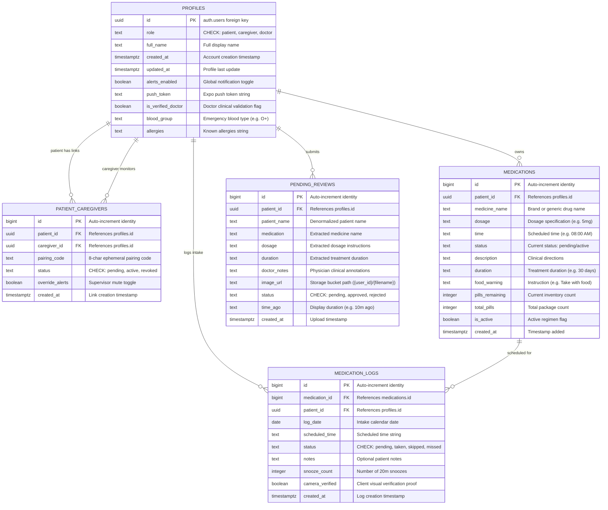
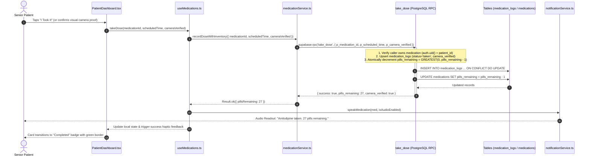
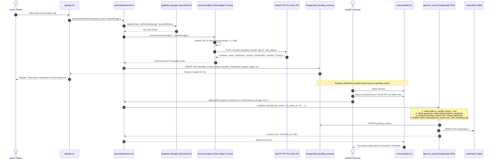
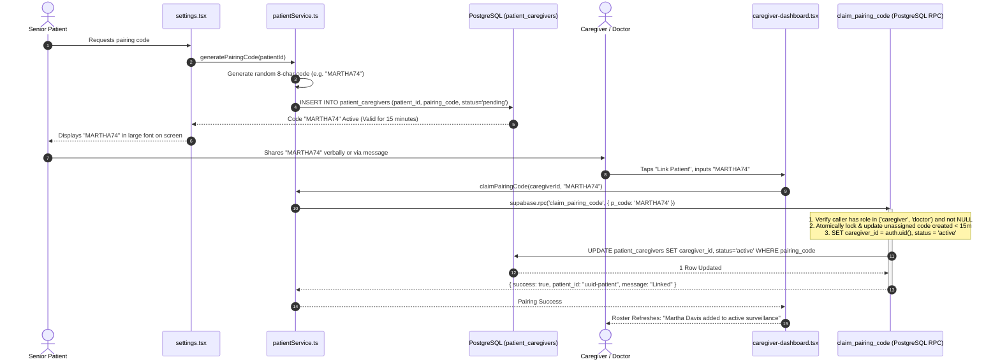
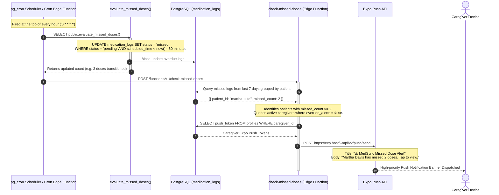
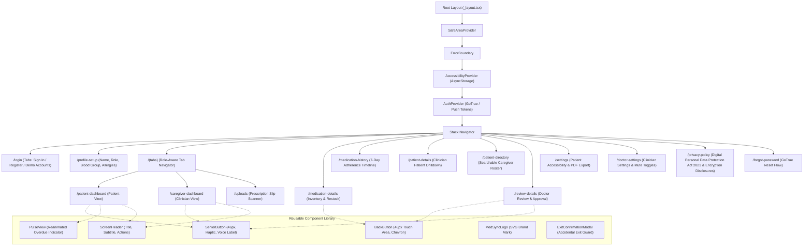
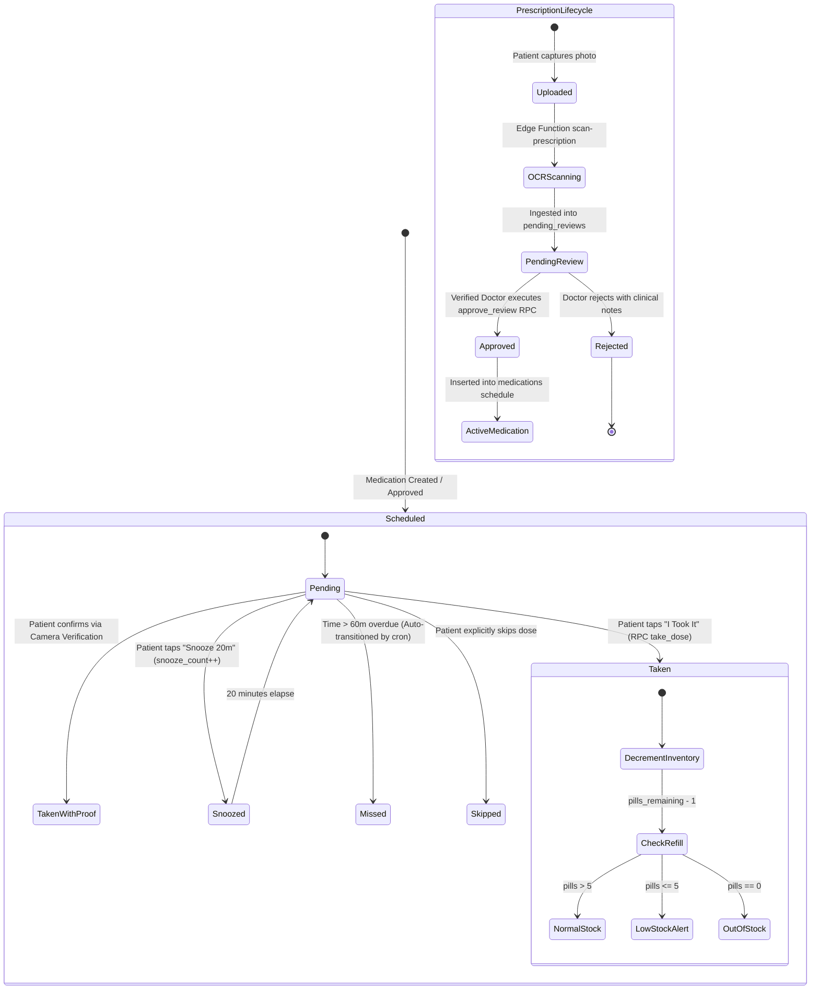

# MedSync: Zero-Context Reconstruction Blueprint & Architecture Guide

> **Document Type:** Technical Architecture Specification & Zero-Context Blueprint  
> **System Name:** MedSync (`medsync-app`)  
> **Target Audience:** Autonomous Coding Agents, Principal Architects & Systems Engineers  
> **Deterministic Re-creation Grade:** Production-Ready / Zero Prior Context Required  

---

## Table of Contents
1. [Visual System Architecture & Topology](#1-visual-system-architecture--topology)
2. [Database Entity-Relationship (ER) Schema Diagram](#2-database-entity-relationship-er-schema-diagram)
3. [End-to-End Data Flow & Sequence Diagrams](#3-end-to-end-data-flow--sequence-diagrams)
   - [3.1 One-Tap Intake & Atomic Inventory Decrement](#31-one-tap-intake--atomic-inventory-decrement)
   - [3.2 Prescription Ingestion, AI OCR & Clinical Approval](#32-prescription-ingestion-ai-ocr--clinical-approval)
   - [3.3 Cryptographic Caregiver Pairing Protocol](#33-cryptographic-caregiver-pairing-protocol)
   - [3.4 Automated Missed Dose Surveillance & Cron Engine](#34-automated-missed-dose-surveillance--cron-engine)
4. [Component & Navigation Hierarchy](#4-component--navigation-hierarchy)
5. [State Machine & Lifecycle Transitions](#5-state-machine--lifecycle-transitions)
6. [Complete Database Schema DDL & Stored Procedures](#6-complete-database-schema-ddl--stored-procedures)
7. [API Catalog & Edge Functions](#7-api-catalog--edge-functions)
8. [Annotated Directory Structure & Source Manifest](#8-annotated-directory-structure--source-manifest)
9. [Dependencies & Environment Configuration](#9-dependencies--environment-configuration)
10. [Step-by-Step Deterministic Reconstruction Sequence](#10-step-by-step-deterministic-reconstruction-sequence)

---

## 1. Visual System Architecture & Topology

```mermaid
graph TB
    subgraph ClientLayer ["Mobile Client Runtime (React Native 0.86 / Expo SDK 57)"]
        subgraph UI ["Presentation & UI Layer"]
            SeniorDashboard["Senior Patient Dashboard<br/>(High Contrast, 46px Targets)"]
            DoctorDashboard["Clinician Surveillance Dashboard<br/>(Realtime WebSocket Roster)"]
            UploadScreen["Prescription Scanner<br/>(Image Picker / Camera)"]
            SettingsScreen["Accessibility & PDF Export<br/>(TTS & Sanitized HTML-to-PDF)"]
        end

        subgraph StateManagement ["State & Context Orchestration"]
            AuthCtx["AuthProvider<br/>(GoTrue Session / Push Registration)"]
            AccessCtx["AccessibilityProvider<br/>(High Contrast / Audio Readouts)"]
            MedHook["useMedications Hook"]
            RosterHook["useCaregiverRoster Hook"]
            ReviewHook["usePrescriptionReview Hook"]
        end

        subgraph ServicesLayer ["Domain Services & Client Infrastructure"]
            ApiClient["safeApiCall Monad Wrapper (Result Pattern)"]
            MedService["medicationService"]
            PrescService["prescriptionService"]
            PatientService["patientService"]
            NotifService["notificationService (Speech / Local Alarms)"]
            ChunkStore["EncryptedSecureStoreAdapter<br/>(Android 2048-Byte Chunking Engine)"]
        end
    end

    subgraph SupabaseCloud ["Supabase Cloud Infrastructure"]
        subgraph Gateway ["Edge & Auth Gateway"]
            GoTrue["GoTrue Auth Engine<br/>(JWT Tokens & Refresh)"]
            Storage["Private Storage Bucket<br/>('prescriptions' / Per-User RLS)"]
        end

        subgraph EdgeFunctions ["Deno 2 Serverless Functions"]
            OcrEdge["scan-prescription<br/>(Payload Guard <= 4.2MB)"]
            CronEdge["check-missed-doses<br/>(Hourly Telemetry Worker)"]
        end

        subgraph PostgresEngine ["PostgreSQL 15+ Relational Database"]
            subgraph SecurityLayer ["Security & Access Control"]
                RLS["Row-Level Security Policies<br/>(Tenant Isolation & Supervisor Delegation)"]
                Triggers["trg_protect_profile_fields<br/>(Role Escalation Block)"]
                InvokerViews["Security-Invoker Views<br/>(doctor_push_tokens, patient_push_tokens)"]
            end

            subgraph Tables ["Relational Tables"]
                T_Profiles[("profiles")]
                T_Caregivers[("patient_caregivers")]
                T_Medications[("medications")]
                T_Logs[("medication_logs")]
                T_Reviews[("pending_reviews")]
            end

            subgraph StoredProcs ["Transactional RPCs (SECURITY DEFINER)"]
                RPC_TakeDose["take_dose(med_id, time, camera_verified)"]
                RPC_Approve["approve_review(review_id, med, dose, duration)"]
                RPC_Pair["claim_pairing_code(pairing_code)"]
                RPC_EvalMissed["evaluate_missed_doses()"]
            end

            Realtime["Postgres Changes (WSS Replication)"]
            PgCron["pg_cron Scheduler (Hourly '0 * * * *')"]
        end
    end

    subgraph ExternalServices ["External Cloud Services"]
        OpenAI["OpenAI API (GPT-4o Vision OCR)"]
        ExpoPush["Expo Push Notification Servers"]
    end

    %% UI to State
    SeniorDashboard --> MedHook
    DoctorDashboard --> RosterHook
    DoctorDashboard --> ReviewHook
    UploadScreen --> PrescService

    %% Hooks to Services
    MedHook --> MedService
    MedHook --> NotifService
    RosterHook --> PatientService
    ReviewHook --> PrescService

    %% Services to Client Infra
    MedService --> ApiClient
    PrescService --> ApiClient
    PatientService --> ApiClient
    ApiClient --> ChunkStore

    %% Client to Supabase Gateway
    ChunkStore -->|Encrypted Session| GoTrue
    UploadScreen -->|Direct Upload| Storage
    PrescService -->|Invoke| OcrEdge
    RosterHook -->|Subscribe WSS| Realtime

    %% Edge Functions to Database & External
    OcrEdge -->|Validate User JWT| GoTrue
    OcrEdge -->|Base64 Image Payload| OpenAI
    CronEdge -->|SUPABASE_SERVICE_ROLE_KEY| T_Logs
    CronEdge -->|Send Alert Payload| ExpoPush

    %% Realtime & Cron inside DB
    PgCron -->|Execute Hourly| RPC_EvalMissed
    T_Logs --> Realtime
    T_Reviews --> Realtime

    %% Stored Procs & Tables
    RPC_TakeDose --> T_Logs
    RPC_TakeDose --> T_Medications
    RPC_Approve --> T_Reviews
    RPC_Approve --> T_Medications
    RPC_Pair --> T_Caregivers
    RPC_EvalMissed --> T_Logs
```



---

## 2. Database Entity-Relationship (ER) Schema Diagram



---

## 3. End-to-End Data Flow & Sequence Diagrams

### 3.1 One-Tap Intake & Atomic Inventory Decrement
This sequence guarantees that pill decrementing and intake logging happen within a single atomic database transaction, preventing duplicate clicks or race conditions:



---

### 3.2 Prescription Ingestion, AI OCR & Clinical Approval
The prescription review pipeline bridges image capture, serverless vision processing, and clinician approval:



---

### 3.3 Cryptographic Caregiver Pairing Protocol
This flow allows a patient to link with a family caregiver or physician without transmitting sensitive patient IDs over unsecured channels:



---

### 3.4 Automated Missed Dose Surveillance & Cron Engine



---

## 4. Component & Navigation Hierarchy



---

## 5. State Machine & Lifecycle Transitions



---

## 6. Complete Database Schema DDL & Stored Procedures

Below is the complete SQL DDL required to configure a production PostgreSQL instance. Execute this in your Supabase SQL Editor:

```sql
-- =============================================================================
-- MedSync Database DDL & Stored Procedures
-- Compatible with PostgreSQL 15+ & Supabase GoTrue Auth
-- =============================================================================

CREATE EXTENSION IF NOT EXISTS "uuid-ossp";
CREATE EXTENSION IF NOT EXISTS "pgcrypto";

-- 1. PROFILES TABLE
CREATE TABLE public.profiles (
    id UUID PRIMARY KEY REFERENCES auth.users(id) ON DELETE CASCADE,
    role TEXT CHECK (role IN ('patient', 'caregiver', 'doctor')),
    full_name TEXT NOT NULL,
    created_at TIMESTAMPTZ DEFAULT TIMEZONE('utc'::text, NOW()) NOT NULL,
    updated_at TIMESTAMPTZ DEFAULT TIMEZONE('utc'::text, NOW()) NOT NULL,
    alerts_enabled BOOLEAN DEFAULT TRUE NOT NULL,
    push_token TEXT,
    is_verified_doctor BOOLEAN DEFAULT FALSE NOT NULL,
    blood_group TEXT,
    allergies TEXT
);

ALTER TABLE public.profiles ENABLE ROW LEVEL SECURITY;

CREATE POLICY "Users can view own profile" 
ON public.profiles FOR SELECT TO authenticated 
USING (auth.uid() = id);

CREATE POLICY "Caregivers can view linked patient profiles" 
ON public.profiles FOR SELECT TO authenticated 
USING (
    EXISTS (
        SELECT 1 FROM public.patient_caregivers pc
        WHERE pc.caregiver_id = auth.uid()
          AND pc.patient_id = profiles.id
          AND pc.status = 'active'
    )
);

CREATE POLICY "Users insert own profile" 
ON public.profiles FOR INSERT TO authenticated 
WITH CHECK (
    auth.uid() = id 
    AND is_verified_doctor = FALSE 
    AND role IN ('patient', 'caregiver')
);

CREATE POLICY "Users can update own non-sensitive profile fields" 
ON public.profiles FOR UPDATE TO authenticated 
USING (auth.uid() = id);

-- Prevent unauthorized role escalation
CREATE OR REPLACE FUNCTION public.protect_profile_fields()
RETURNS TRIGGER LANGUAGE plpgsql AS $$
BEGIN
    IF current_user <> 'service_role' THEN
        NEW.is_verified_doctor := OLD.is_verified_doctor;
        NEW.role := OLD.role;
    END IF;
    RETURN NEW;
END;
$$;

CREATE TRIGGER trg_protect_profile_fields
BEFORE UPDATE ON public.profiles
FOR EACH ROW EXECUTE FUNCTION public.protect_profile_fields();


-- 2. PATIENT_CAREGIVERS TABLE
CREATE TABLE public.patient_caregivers (
    id BIGINT GENERATED BY DEFAULT AS IDENTITY PRIMARY KEY,
    patient_id UUID NOT NULL REFERENCES public.profiles(id) ON DELETE CASCADE,
    caregiver_id UUID REFERENCES public.profiles(id) ON DELETE SET NULL,
    pairing_code TEXT,
    status TEXT DEFAULT 'pending' NOT NULL CHECK (status IN ('pending', 'active', 'revoked')),
    override_alerts BOOLEAN DEFAULT FALSE NOT NULL,
    created_at TIMESTAMPTZ DEFAULT TIMEZONE('utc'::text, NOW()) NOT NULL
);

CREATE INDEX idx_patient_caregivers_pairing_code ON public.patient_caregivers(pairing_code);
CREATE INDEX idx_patient_caregivers_lookup ON public.patient_caregivers(patient_id, caregiver_id);

ALTER TABLE public.patient_caregivers ENABLE ROW LEVEL SECURITY;

CREATE POLICY "Patients view own pairings" 
ON public.patient_caregivers FOR SELECT TO authenticated 
USING (patient_id = auth.uid());

CREATE POLICY "Patients create pairing invitations" 
ON public.patient_caregivers FOR INSERT TO authenticated 
WITH CHECK (patient_id = auth.uid());

CREATE POLICY "Caregivers see own active links" 
ON public.patient_caregivers FOR SELECT TO authenticated 
USING (caregiver_id = auth.uid() AND status = 'active');

CREATE POLICY "Caregivers update alert overrides on linked patients" 
ON public.patient_caregivers FOR UPDATE TO authenticated 
USING (caregiver_id = auth.uid() AND status = 'active');


-- 3. MEDICATIONS TABLE
CREATE TABLE public.medications (
    id BIGINT GENERATED BY DEFAULT AS IDENTITY PRIMARY KEY,
    patient_id UUID NOT NULL REFERENCES public.profiles(id) ON DELETE CASCADE,
    medicine_name TEXT NOT NULL,
    dosage TEXT NOT NULL,
    time TEXT NOT NULL,
    status TEXT DEFAULT 'pending' NOT NULL,
    description TEXT,
    duration TEXT,
    food_warning TEXT,
    pills_remaining INTEGER DEFAULT 30,
    total_pills INTEGER DEFAULT 30,
    is_active BOOLEAN DEFAULT TRUE NOT NULL,
    created_at TIMESTAMPTZ DEFAULT TIMEZONE('utc'::text, NOW()) NOT NULL
);

CREATE INDEX idx_medications_patient ON public.medications(patient_id);

ALTER TABLE public.medications ENABLE ROW LEVEL SECURITY;

CREATE POLICY "Patients manage own medications" 
ON public.medications FOR ALL TO authenticated 
USING (patient_id = auth.uid())
WITH CHECK (patient_id = auth.uid());

CREATE POLICY "Active caregivers view patient medications" 
ON public.medications FOR SELECT TO authenticated 
USING (
    EXISTS (
        SELECT 1 FROM public.patient_caregivers pc
        WHERE pc.patient_id = medications.patient_id
          AND pc.caregiver_id = auth.uid()
          AND pc.status = 'active'
    )
);


-- 4. MEDICATION_LOGS TABLE
CREATE TABLE public.medication_logs (
    id BIGINT GENERATED BY DEFAULT AS IDENTITY PRIMARY KEY,
    medication_id BIGINT NOT NULL REFERENCES public.medications(id) ON DELETE CASCADE,
    patient_id UUID NOT NULL REFERENCES public.profiles(id) ON DELETE CASCADE,
    log_date DATE DEFAULT CURRENT_DATE NOT NULL,
    scheduled_time TEXT NOT NULL,
    status TEXT NOT NULL CHECK (status IN ('pending', 'taken', 'skipped', 'missed')),
    notes TEXT,
    snooze_count INTEGER DEFAULT 0 NOT NULL,
    camera_verified BOOLEAN DEFAULT FALSE NOT NULL,
    created_at TIMESTAMPTZ DEFAULT TIMEZONE('utc'::text, NOW()) NOT NULL,
    CONSTRAINT uq_medication_log_daily UNIQUE (medication_id, log_date)
);

CREATE INDEX idx_medication_logs_query ON public.medication_logs(patient_id, log_date);

ALTER TABLE public.medication_logs ENABLE ROW LEVEL SECURITY;

CREATE POLICY "Patients manage own intake logs" 
ON public.medication_logs FOR ALL TO authenticated 
USING (patient_id = auth.uid())
WITH CHECK (patient_id = auth.uid());

CREATE POLICY "Active caregivers view patient intake logs" 
ON public.medication_logs FOR SELECT TO authenticated 
USING (
    EXISTS (
        SELECT 1 FROM public.patient_caregivers pc
        WHERE pc.patient_id = medication_logs.patient_id
          AND pc.caregiver_id = auth.uid()
          AND pc.status = 'active'
    )
);


-- 5. PENDING_REVIEWS TABLE
CREATE TABLE public.pending_reviews (
    id BIGINT GENERATED BY DEFAULT AS IDENTITY PRIMARY KEY,
    patient_id UUID REFERENCES public.profiles(id) ON DELETE CASCADE,
    patient_name TEXT NOT NULL,
    medication TEXT NOT NULL,
    dosage TEXT,
    duration TEXT,
    doctor_notes TEXT,
    image_url TEXT NOT NULL,
    status TEXT DEFAULT 'pending' NOT NULL CHECK (status IN ('pending', 'approved', 'rejected')),
    time_ago TEXT DEFAULT 'Just now',
    created_at TIMESTAMPTZ DEFAULT TIMEZONE('utc'::text, NOW()) NOT NULL
);

ALTER TABLE public.pending_reviews ENABLE ROW LEVEL SECURITY;

CREATE POLICY "Patients view own submitted reviews" 
ON public.pending_reviews FOR SELECT TO authenticated 
USING (patient_id = auth.uid());

CREATE POLICY "Patients insert pending reviews" 
ON public.pending_reviews FOR INSERT TO authenticated 
WITH CHECK (patient_id = auth.uid());

CREATE POLICY "Caregivers view assigned patient reviews" 
ON public.pending_reviews FOR SELECT TO authenticated 
USING (
    EXISTS (
        SELECT 1 FROM public.patient_caregivers pc
        WHERE pc.patient_id = pending_reviews.patient_id
          AND pc.caregiver_id = auth.uid()
          AND pc.status = 'active'
    )
);


-- 6. PRIVATE STORAGE BUCKET: prescriptions
INSERT INTO storage.buckets (id, name, public)
VALUES ('prescriptions', 'prescriptions', FALSE)
ON CONFLICT (id) DO UPDATE SET public = FALSE;

CREATE POLICY "upload own folder" ON storage.objects
FOR INSERT TO authenticated
WITH CHECK (
    bucket_id = 'prescriptions' 
    AND (storage.foldername(name))[1] = auth.uid()::text
);

CREATE POLICY "read own or linked patient" ON storage.objects
FOR SELECT TO authenticated
USING (
    bucket_id = 'prescriptions' 
    AND (
        (storage.foldername(name))[1] = auth.uid()::text
        OR (storage.foldername(name))[1]::uuid IN (
            SELECT patient_id 
            FROM public.patient_caregivers 
            WHERE caregiver_id = auth.uid() 
              AND status = 'active'
        )
    )
);


-- 7. SECURITY INVOKER VIEWS
CREATE OR REPLACE VIEW public.doctor_push_tokens WITH (security_invoker = TRUE) AS
SELECT 
    pc.patient_id,
    p.push_token,
    pc.caregiver_id
FROM public.patient_caregivers pc
JOIN public.profiles p ON pc.caregiver_id = p.id
WHERE p.push_token IS NOT NULL;

CREATE OR REPLACE VIEW public.patient_push_tokens WITH (security_invoker = TRUE) AS
SELECT 
    pc.caregiver_id,
    p.id AS patient_id,
    p.push_token
FROM public.patient_caregivers pc
JOIN public.profiles p ON pc.patient_id = p.id
WHERE p.push_token IS NOT NULL;

REVOKE ALL ON public.doctor_push_tokens FROM anon;
REVOKE ALL ON public.patient_push_tokens FROM anon;


-- 8. STORED PROCEDURES (RPCs)

-- A. Claim Pairing Code
CREATE OR REPLACE FUNCTION public.claim_pairing_code(p_code TEXT)
RETURNS JSONB LANGUAGE plpgsql SECURITY DEFINER SET search_path = public AS $$
DECLARE
    v_caller_id UUID := auth.uid();
    v_caller_role TEXT;
    v_record RECORD;
BEGIN
    SELECT role INTO v_caller_role FROM profiles WHERE id = v_caller_id;
    IF v_caller_role NOT IN ('caregiver', 'doctor') THEN
        RAISE EXCEPTION 'Only caregivers or doctors can claim pairing codes';
    END IF;

    UPDATE patient_caregivers
    SET caregiver_id = v_caller_id,
        status = 'active'
    WHERE pairing_code = upper(trim(p_code))
      AND caregiver_id IS NULL
      AND created_at > (NOW() - INTERVAL '24 hours')
    RETURNING * INTO v_record;

    IF NOT FOUND THEN
        RAISE EXCEPTION 'Invalid, expired, or already claimed pairing code';
    END IF;

    RETURN jsonb_build_object(
        'success', TRUE,
        'patient_id', v_record.patient_id,
        'message', 'Patient successfully linked'
    );
END;
$$;

-- B. Atomic Dose Intake with Camera Proof
CREATE OR REPLACE FUNCTION public.take_dose(
    p_medication_id BIGINT,
    p_scheduled_time TEXT DEFAULT '00:00',
    p_camera_verified BOOLEAN DEFAULT FALSE
)
RETURNS JSONB LANGUAGE plpgsql SECURITY DEFINER SET search_path = public AS $$
DECLARE
    v_patient_id UUID := auth.uid();
    v_today DATE := CURRENT_DATE;
    v_new_pills INT;
    v_med_name TEXT;
BEGIN
    SELECT medicine_name INTO v_med_name
    FROM medications
    WHERE id = p_medication_id AND patient_id = v_patient_id;

    IF NOT FOUND THEN
        RAISE EXCEPTION 'Medication not found or unauthorized';
    END IF;

    INSERT INTO medication_logs (
        medication_id,
        patient_id,
        log_date,
        scheduled_time,
        status,
        camera_verified
    ) VALUES (
        p_medication_id,
        v_patient_id,
        v_today,
        p_scheduled_time,
        'taken',
        p_camera_verified
    )
    ON CONFLICT (medication_id, log_date)
    DO UPDATE SET
        status = 'taken',
        camera_verified = EXCLUDED.camera_verified;

    UPDATE medications
    SET pills_remaining = GREATEST(0, COALESCE(pills_remaining, 30) - 1)
    WHERE id = p_medication_id AND patient_id = v_patient_id
    RETURNING pills_remaining INTO v_new_pills;

    RETURN jsonb_build_object(
        'success', TRUE,
        'pills_remaining', v_new_pills,
        'medicine_name', v_med_name,
        'camera_verified', p_camera_verified
    );
END;
$$;

-- C. Atomic Prescription Approval
CREATE OR REPLACE FUNCTION public.approve_review(
    p_review_id BIGINT,
    p_medicine_name TEXT,
    p_dosage TEXT,
    p_duration TEXT,
    p_time TEXT DEFAULT '08:00 AM',
    p_doctor_notes TEXT DEFAULT NULL
)
RETURNS JSONB LANGUAGE plpgsql SECURITY DEFINER SET search_path = public AS $$
DECLARE
    v_caller_id UUID := auth.uid();
    v_caller_profile RECORD;
    v_review RECORD;
    v_med_id BIGINT;
BEGIN
    SELECT * INTO v_caller_profile FROM profiles WHERE id = v_caller_id;
    IF v_caller_profile IS NULL OR v_caller_profile.is_verified_doctor = FALSE THEN
        RAISE EXCEPTION 'Unauthorized: only verified physicians can approve prescriptions';
    END IF;

    SELECT * INTO v_review FROM pending_reviews WHERE id = p_review_id;
    IF NOT FOUND THEN
        RAISE EXCEPTION 'Prescription review not found';
    END IF;

    IF NOT EXISTS (
        SELECT 1 FROM patient_caregivers
        WHERE patient_id = v_review.patient_id
          AND caregiver_id = v_caller_id
          AND status = 'active'
    ) THEN
        RAISE EXCEPTION 'Unauthorized: you are not an active supervisor for this patient';
    END IF;

    UPDATE pending_reviews
    SET status = 'approved',
        medication = p_medicine_name,
        dosage = p_dosage,
        duration = p_duration,
        doctor_notes = p_doctor_notes
    WHERE id = p_review_id;

    INSERT INTO medications (
        patient_id,
        medicine_name,
        dosage,
        time,
        status,
        duration,
        description,
        pills_remaining,
        total_pills,
        is_active
    ) VALUES (
        v_review.patient_id,
        p_medicine_name,
        p_dosage,
        p_time,
        'pending',
        p_duration,
        p_doctor_notes,
        30,
        30,
        TRUE
    ) RETURNING id INTO v_med_id;

    RETURN jsonb_build_object(
        'success', TRUE,
        'medication_id', v_med_id,
        'patient_id', v_review.patient_id,
        'medicine_name', p_medicine_name
    );
END;
$$;

-- D. Automated Overdue Dose Transition
CREATE OR REPLACE FUNCTION public.evaluate_missed_doses()
RETURNS INT LANGUAGE plpgsql SECURITY DEFINER SET search_path = public AS $$
DECLARE
    v_updated_count INT := 0;
BEGIN
    WITH updated AS (
        UPDATE medication_logs
        SET status = 'missed'
        WHERE status = 'pending'
          AND (
            log_date < CURRENT_DATE
            OR (
                log_date = CURRENT_DATE
                AND scheduled_time IS NOT NULL
                AND scheduled_time <> ''
                AND scheduled_time::time < (CURRENT_TIME - INTERVAL '60 minutes')
            )
          )
        RETURNING id
    )
    SELECT count(*) INTO v_updated_count FROM updated;

    RETURN v_updated_count;
END;
$$;
```

---

## 7. API Catalog & Edge Functions

### 1. Edge Function: `POST /functions/v1/scan-prescription`
- **File:** `supabase/functions/scan-prescription/index.ts`
- **Authentication:** `Bearer <JWT>` from authenticated user.
- **Request Headers:** `Authorization: Bearer <token>`, `Content-Type: application/json`
- **Request Payload:**
  ```json
  {
    "base64Image": "data:image/jpeg;base64,/9j/4AAQSkZJRgABAQ..."
  }
  ```
- **Validation Rules:**
  - Base64 string must not exceed 4.2 MB (~3 MB binary).
  - Must include valid JWT session header.
- **Response (`200 OK`):**
  ```json
  {
    "medicine_name": "Atorvastatin",
    "dosage": "20mg daily at bedtime",
    "duration": "90 days"
  }
  ```

### 2. Edge Function: `POST /functions/v1/check-missed-doses`
- **File:** `supabase/functions/check-missed-doses/index.ts`
- **Authentication:** Admin Service Role Key (`SUPABASE_SERVICE_ROLE_KEY`).
- **Execution Target:** Hourly background cron worker.
- **Response (`200 OK`):**
  ```json
  {
    "success": true,
    "flagged_patients_count": 1,
    "notifications_sent_count": 1,
    "details": [
      {
        "caregiver_id": "00000000-0000-0000-0000-000000000001",
        "patient_id": "00000000-0000-0000-0000-000000000002",
        "status": "sent"
      }
    ]
  }
  ```

---

## 8. Annotated Directory Structure & Source Manifest

```
medsync-app/
├── app.json                                 # Manifest: bundle id, permissions, EAS project
├── tsconfig.json                            # TypeScript configuration with @/* aliases
├── .env.example                             # Environment variable template
├── scripts/
│   ├── patch-expo-notifications.js          # Neutralizes fatal throws on Expo Go Android
│   └── seed_demo_accounts.sql               # Populates doctor, patients, and medications
├── src/
│   ├── app/
│   │   ├── _layout.tsx                      # Root Layout, fonts, interactive notification listener
│   │   ├── (tabs)/
│   │   │   ├── _layout.tsx                  # Role-aware Tab Bar & double-back exit handler
│   │   │   ├── patient-dashboard.tsx        # Senior 4-quadrant schedule & one-tap intake
│   │   │   ├── caregiver-dashboard.tsx      # Clinician real-time surveillance & review queue
│   │   │   └── uploads.tsx                  # Prescription slip scanner & OCR ingestion
│   │   ├── login.tsx                        # Tabbed auth & 1-tap demo logins
│   │   ├── profile-setup.tsx                # Onboarding profile completion
│   │   ├── medication-details.tsx           # Pill inventory & restock dialog
│   │   ├── medication-history.tsx           # 7-day adherence timeline
│   │   ├── patient-details.tsx              # Clinician patient inspection & alert mute
│   │   ├── patient-directory.tsx            # Patient search & pairing code redemption
│   │   ├── review-details.tsx               # Prescription review & clinical approval
│   │   ├── settings.tsx                     # Accessibility toggles, pairing code, PDF report
│   │   ├── doctor-settings.tsx              # Clinician settings & push notification toggles
│   │   └── privacy-policy.tsx               # India DPDP Act 2023 & encryption disclosures
│   ├── components/
│   │   ├── SeniorButton.tsx                 # 46px touch target accessibility button
│   │   ├── BackButton.tsx                   # Standardized back navigation
│   │   ├── ScreenHeader.tsx                 # Unified screen title and action bar
│   │   ├── PulseView.tsx                    # Reanimated overdue warning ring
│   │   ├── MedSyncLogo.tsx                  # Vector brand icon
│   │   ├── ExitConfirmationModal.tsx        # Senior accidental exit dialog
│   │   └── ErrorBoundary.tsx                # Top-level render error boundary
│   ├── config/
│   │   └── env.ts                           # Typed environment configuration
│   ├── context/
│   │   ├── authcontext.tsx                  # Global user session & push token registration
│   │   └── AccessibilityContext.tsx         # High-contrast & audio TTS preferences
│   ├── hooks/
│   │   ├── useMedications.ts                # Daily schedule & intake orchestration
│   │   ├── useCaregiverRoster.ts            # Surveillance roster & Realtime WSS sync
│   │   └── usePrescriptionReview.ts         # Prescription review queue management
│   ├── lib/
│   │   ├── crashReporter.ts                 # Sentry-compatible diagnostic logger
│   │   └── supabase.ts                      # Supabase client with chunked SecureStore
│   ├── services/
│   │   ├── apiClient.ts                     # Result<T> safe API execution wrapper
│   │   ├── authService.ts                   # Authentication & profile management
│   │   ├── medicationService.ts             # Daily schedule & intake logging
│   │   ├── notificationService.ts           # Speech synthesis & local alarms
│   │   ├── patientService.ts                # Caregiver linking & missed dose checks
│   │   └── prescriptionService.ts           # Storage upload & OCR pipeline
│   ├── theme/
│   │   └── index.ts                         # Color palette, typography & senior metrics
│   ├── types/                               # TypeScript domain model declarations
│   └── utils/
│       ├── errorHandler.ts                  # Centralized error normalization
│       └── timeUtils.ts                     # Schedule parsing & day quadrant binning
├── supabase/
│   ├── functions/
│   │   ├── scan-prescription/index.ts       # OpenAI GPT-4o Vision OCR worker
│   │   └── check-missed-doses/index.ts      # Automated missed dose notifier
│   └── migrations/                          # Database migration history
└── tests/
    ├── architecture_and_services.test.js    # Unit tests: time, Result monad, errors
    └── security_and_integrity.test.js       # Security tests: RLS, tokens, sanitization
```

---

## 9. Dependencies & Environment Configuration

### Dependencies Table
```json
{
  "dependencies": {
    "expo": "~57.0.30",
    "react": "19.2.3",
    "react-dom": "19.2.3",
    "react-native": "0.86.3",
    "expo-router": "~57.0.28",
    "@supabase/supabase-js": "^2.112.4",
    "base64-arraybuffer": "^1.0.2",
    "expo-notifications": "~57.0.23",
    "expo-speech": "~57.0.3",
    "expo-haptics": "~57.0.3",
    "expo-secure-store": "~57.0.4",
    "@react-native-async-storage/async-storage": "2.2.0",
    "expo-image-picker": "~57.0.20",
    "expo-image": "~57.0.5",
    "expo-print": "~57.0.2",
    "expo-sharing": "~57.0.23",
    "expo-font": "~57.0.2",
    "expo-splash-screen": "~57.0.10",
    "react-native-reanimated": "4.5.1",
    "react-native-safe-area-context": "~5.7.0",
    "react-native-screens": "~4.26.0",
    "react-native-svg": "15.15.4",
    "@expo/vector-icons": "^15.0.2",
    "react-native-url-polyfill": "^4.0.0"
  }
}
```

### Environment Variables Template (`.env`)
```ini
EXPO_PUBLIC_SUPABASE_URL=https://your-project-id.supabase.co
EXPO_PUBLIC_SUPABASE_ANON_KEY=eyJhbGciOiJIUzI1NiIsInR5cCI6IkpXVCJ9.dummyAnonymousKeyPayload
EXPO_PUBLIC_EAS_PROJECT_ID=00000000-0000-0000-0000-000000000000
EXPO_PUBLIC_SENTRY_DSN=https://dummyPublicKey@o0.ingest.sentry.io/0
```

---

## 10. Step-by-Step Deterministic Reconstruction Sequence

```powershell
# 1. Initialize Expo Project
npx -y create-expo-app@latest ./ --template blank-typescript

# 2. Install Required Dependencies
npm install react@19.2.3 react-dom@19.2.3 react-native@0.86.3 expo@~57.0.30 expo-router@~57.0.28 @supabase/supabase-js@^2.112.4 base64-arraybuffer@^1.0.2 react-native-url-polyfill@^4.0.0 expo-notifications@~57.0.23 expo-speech@~57.0.3 expo-haptics@~57.0.3 expo-secure-store@~57.0.4 @react-native-async-storage/async-storage@2.2.0 expo-image-picker@~57.0.20 expo-image@~57.0.5 expo-print@~57.0.2 expo-sharing@~57.0.23 expo-font@~57.0.2 expo-splash-screen@~57.0.10 expo-status-bar@~57.0.1 expo-constants@~57.0.16 expo-device@~57.0.2 expo-linking@~57.0.13 expo-web-browser@~57.0.3 expo-system-ui@~57.0.4 expo-file-system@~57.0.6 expo-glass-effect@~57.0.4 expo-symbols@~57.0.3 expo-dev-client@~57.0.20 react-native-reanimated@4.5.1 react-native-safe-area-context@~5.7.0 react-native-screens@~4.26.0 react-native-svg@15.15.4 @expo/vector-icons@^15.0.2 react-native-gesture-handler@~2.32.0 react-native-worklets@0.10.1

# 3. Setup PostgreSQL Database
# Run Section 6 SQL DDL in the Supabase SQL Editor, followed by scripts/seed_demo_accounts.sql

# 4. Run Unit and Security Tests
npm test
# Verify: 26 passed, 0 failed, 12 suites passed

# 5. Verify Static Typing
npx tsc --noEmit

# 6. Launch Application Locally
npm start
```
