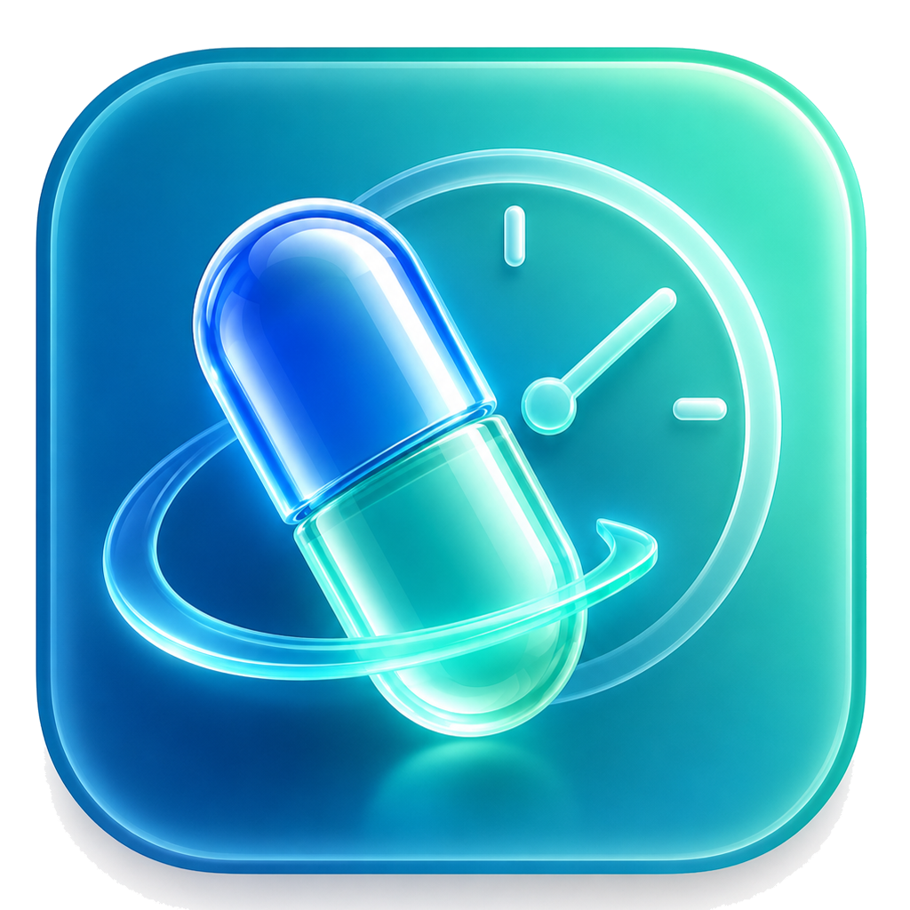
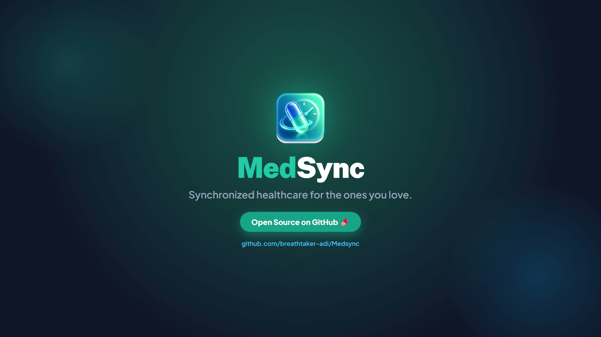
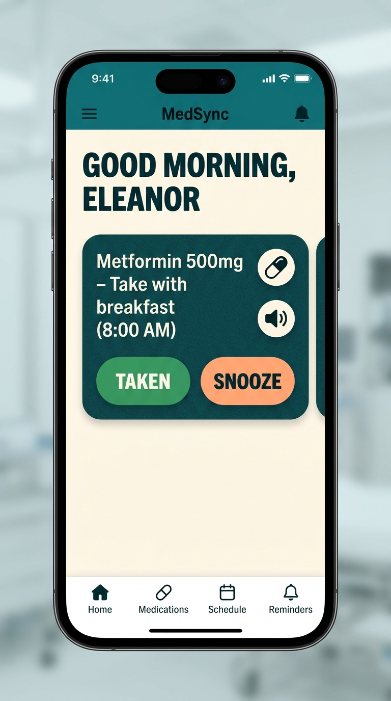
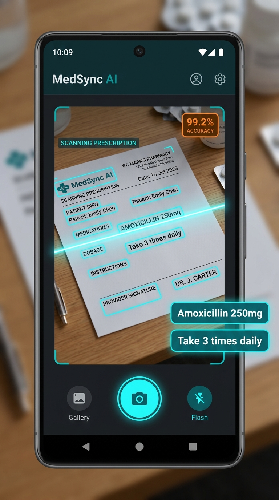
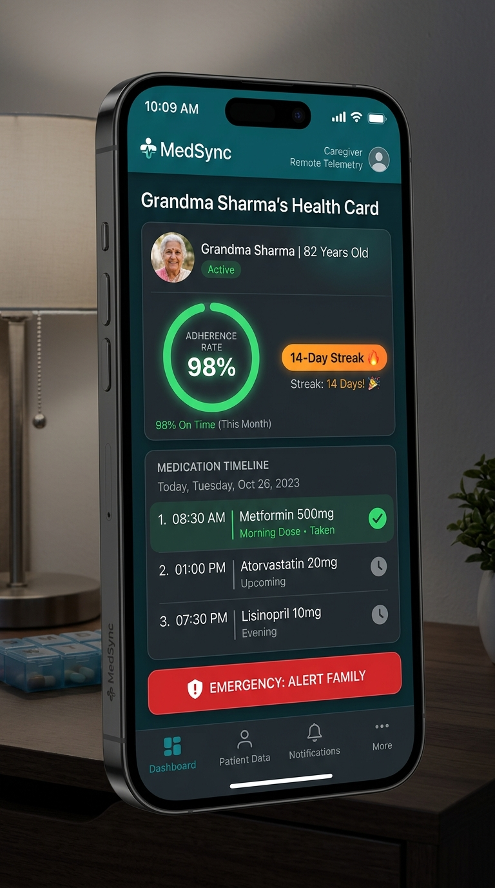
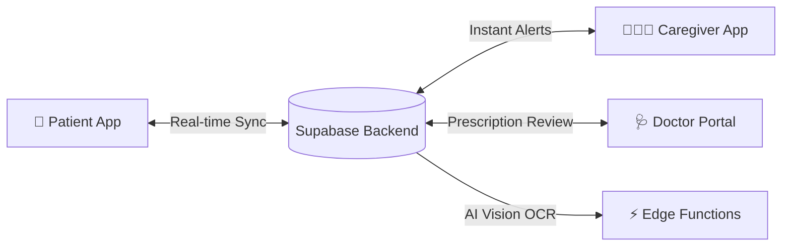
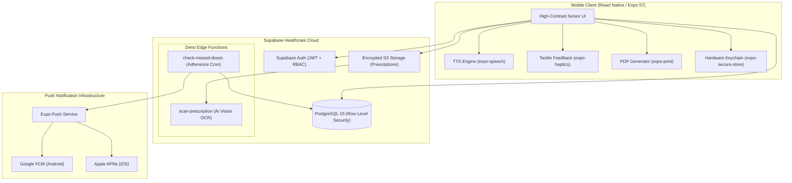

<p align="center">
  
</p>

<h1 align="center">MedSync — Smart Medication Adherence, AI Prescription OCR & Caregiver Platform 💊</h1>

<p align="center">
  <strong>An accessible, intelligent, and secure mobile health (mHealth) platform bridging seniors, caregivers, and licensed physicians to eliminate preventable medication errors and maximize therapy adherence.</strong>
</p>

<p align="center">
  <a href="https://breathtaker-adi.github.io/Medsync/">
    
  </a>
  <a href="https://github.com/breathtaker-adi/Medsync/releases">
    
  </a>
  <a href="https://github.com/breathtaker-adi/Medsync/actions/workflows/ci.yml">
    
  </a>
  <a href="https://expo.dev">
    
  </a>
  <a href="https://reactnative.dev">
    
  </a>
  <a href="https://supabase.com">
    
  </a>
  <a href="https://www.typescriptlang.org">
    
  </a>
  <a href="https://github.com/breathtaker-adi/Medsync/blob/main/LICENSE">
    
  </a>
  <a href="#-automated-testing--code-quality">
    
  </a>
  <a href="https://github.com/breathtaker-adi/Medsync/pulls">
    
  </a>
</p>

<p align="center">
  
</p>

<p align="center">
  <a href="https://breathtaker-adi.github.io/Medsync/"><strong>🌐 Live Website</strong></a> &nbsp;•&nbsp;
  <a href="https://github.com/breathtaker-adi/Medsync/releases"><strong>📲 Download APK</strong></a> &nbsp;•&nbsp;
  <a href="SECURITY.md"><strong>🔒 Security Policy</strong></a> &nbsp;•&nbsp;
  <a href="#-getting-started"><strong>🚀 Quickstart</strong></a> &nbsp;•&nbsp;
  <a href="https://github.com/breathtaker-adi/Medsync/issues/new/choose"><strong>🐛 Report Issue</strong></a>
</p>

---

## 📱 Mobile Interface Showcase

<p align="center">
  <em>Accessible Senior UI • AI Vision OCR Scanner • Caregiver Remote Telemetry</em>
</p>

<table align="center" width="100%">
  <tr>
    <td width="33.3%" align="center" valign="top">
      <a href="assets/images/mockup-patient.jpg" target="_blank">
        
      </a>
      <br /><br />
      <strong>👵 Senior Patient Dashboard</strong>
      <br />
      <sub>High contrast (WCAG AAA), 64px touch targets, spoken audio guidance &amp; one-tap dose logging</sub>
    </td>
    <td width="33.3%" align="center" valign="top">
      <a href="assets/images/mockup-scanner.jpg" target="_blank">
        
      </a>
      <br /><br />
      <strong>🤖 AI Prescription Scanner</strong>
      <br />
      <sub>Multi-modal computer vision parsing handwritten scripts into structured medication regimens</sub>
    </td>
    <td width="33.3%" align="center" valign="top">
      <a href="assets/images/mockup-caregiver.jpg" target="_blank">
        
      </a>
      <br /><br />
      <strong>👨‍👩‍👧 Caregiver Telemetry Hub</strong>
      <br />
      <sub>Real-time adherence telemetry, 14-day streak tracking, and automated missed-dose family alerts</sub>
    </td>
  </tr>
</table>

---

## 📑 Table of Contents

- [Overview](#-overview)
- [📱 Mobile Interface Showcase](#-mobile-interface-showcase)
- [Why MedSync?](#-why-medsync)
- [📲 Download Android App (.apk)](#-download-the-android-app-apk)
- [Key Features](#-key-features)
  - [👵 Patient & Senior Experience](#-patient--senior-experience)
  - [👨‍👩‍👧 Caregiver Ecosystem](#-caregiver-ecosystem)
  - [🩺 Doctor & Clinical Portal](#-doctor--clinical-portal)
  - [🤖 AI Vision OCR Prescription Scanner](#-ai-vision-ocr-prescription-scanner)
- [System Architecture](#-system-architecture)
- [Tech Stack](#-tech-stack)
- [🌐 Web Experience](#-web-experience)
- [Security, Privacy & Compliance](#-security-privacy--compliance)
  - [Security Policy & Disclosures](SECURITY.md)
- [Getting Started](#-getting-started)
  - [Prerequisites](#prerequisites)
  - [Quickstart Installation](#quickstart-installation)
  - [Environment Variables](#environment-variables)
- [Automated Testing & Code Quality](#-automated-testing--code-quality)
- [Cloud Build & EAS Deployment](#-cloud-build--eas-deployment)
- [Project Directory Structure](#-project-directory-structure)
- [Contributing](#-contributing)
- [License](#-license)

---

## 🌟 Overview

**MedSync** is an open-source mobile health (mHealth) application engineered with **React Native (Expo SDK 57)** and **Supabase (PostgreSQL 15 + Edge Functions)**. Designed to address medication non-adherence (an estimated $100B–$300B annual burden in healthcare systems; *NEHI / CDC*), MedSync unifies three critical healthcare pillars into a synchronized real-time ecosystem:

1. **Patients / Seniors**: Simplified, high-contrast, voice-guided medication reminders with zero friction.
2. **Family Caregivers**: Remote adherence telemetry, streak metrics, and real-time missed-dose emergency alerts.
3. **Doctors / Clinicians**: Prescription validation, dosage regimen management, and clinical review workflows.



---

## 💡 Why MedSync?

Medication non-adherence leads to over **125,000 preventable deaths** and up to **25% of hospital admissions** each year in the United States alone (Sources: *CDC / Annals of Internal Medicine, 2012; NEHI Research*). Existing reminder apps fail seniors because of tiny fonts, convoluted navigation, lack of caregiver accountability, and tedious manual data entry.

MedSync solves this with:
- **Zero-Typing Regimen Onboarding**: Snap a photo of a doctor's handwritten or printed prescription; our AI Vision OCR engine extracts medications, dosages, and schedules in seconds.
- **Senior-First Accessibility (WCAG AAA)**: Oversized touch targets, dynamic font scaling, tactile haptics, and spoken voice directions.
- **Fail-Safe Caregiver Watch**: If a senior misses a dose or forgets their phone, caregivers receive an urgent notification automatically.

---

## 📲 Download the Android App (.apk)

Experience MedSync natively on your physical Android phone without building from source. Verified standalone `.apk` binaries are published directly under [GitHub Releases](https://github.com/breathtaker-adi/Medsync/releases):

| Version | Status | Target OS | Direct Binary Link | Highlights |
| :--- | :---: | :---: | :---: | :--- |
| **v1.2.0** *(Latest)* | 🟢 Production | Android 8.0 - 15 | [📥 **MedSync-v1.2.0.apk**](https://github.com/breathtaker-adi/Medsync/releases/download/v1.2.0/MedSync-v1.2.0.apk) | Full AI Vision OCR Scanner, Senior UI, Caregiver Telemetry, 67 passing security tests |
| **v1.1** | ⚪ Stable | Android 8.0+ | [📥 MedSync-v1.1.apk](https://github.com/breathtaker-adi/Medsync/releases/download/v1.1/MedSync-v1.1.apk) | Manual medication entry, contact directory, daily streaks |
| **v1.0** | ⚪ Pre-Release | Android 8.0+ | [📥 MedSync-v1.0.apk](https://github.com/breathtaker-adi/Medsync/releases/download/v1.0/MedSync-v1.0.apk) | Baseline adherence scheduler & background alarms |

> [!TIP]
> **Direct Installation Steps**:
> 1. Download **[MedSync-v1.2.0.apk](https://github.com/breathtaker-adi/Medsync/releases/download/v1.2.0/MedSync-v1.2.0.apk)** directly to your Android device.
> 2. Open the downloaded `.apk` file from your device notifications or file manager.
> 3. If prompted by Android, toggle **"Allow from this source"** to permit the sideload.
> 4. Launch MedSync to explore the high-contrast dashboard, spoken voice guidance, and prescription scanner.

---

## ✨ Key Features

<details open>
<summary><h3>👵 Patient & Senior Experience</h3></summary>

Designed specifically for aging eyes, motor tremors, and cognitive comfort:
- **Senior-Optimized Interface**: High-contrast color palettes (WCAG AAA), 24px+ typography, and zero confusing nested menus.
- **Text-to-Speech (TTS) Voice Guidance**: Native voice announcements (`expo-speech`) speak aloud exact medication names and instructions (e.g., *"Take 500mg Metformin with a glass of water"*).
- **Haptic Tactile Confirmations**: Multi-stage haptic vibration feedback (`expo-haptics`) confirms actions for users with tremors or visual limitations.
- **Oversized 64px Touch Targets**: Big, bold `TAKEN`, `SNOOZE (15m)`, and `SKIP` buttons prevent accidental mis-taps.
- **Clinical Adherence Reports & PDF Export**: Generates standardized adherence summaries integrated directly into the native Android OS Print Spooler (`expo-print`).

</details>

<details open>
<summary><h3>👨‍👩‍👧 Caregiver Ecosystem</h3></summary>

Gives adult children and professional caregivers total peace of mind:
- **Remote Telemetry Dashboard**: Live insight into family members' medication intake, streak scores, and adherence rates.
- **Automated Missed-Dose Notifications**: Push alerts triggered automatically if a senior fails to acknowledge medication within the safety grace window.
- **Multi-Patient Support**: Caregivers can monitor multiple aging parents or dependents from a single unified view.
- **Secure Pairing**: Connect with patients in seconds using short alphanumeric pairing codes.

</details>

<details open>
<summary><h3>🩺 Doctor & Clinical Portal</h3></summary>

Bridges clinical regimens directly into patients' daily habits:
- **Physician Credentialing & Registry Verification**: Robust multi-step verification against state/national medical registries.
- **Prescription Review Queue**: Doctors inspect patient-uploaded prescription images alongside AI-extracted metadata before approving regimens.
- **Patient Directory & Regimen Management**: Directly adjust active dosages, pause medications for lab tests, and track compliance trends.
- **Defense-in-Depth Clinical Security**: Row-level access control guarantees strict patient confidentiality.

</details>

<details open>
<summary><h3>🤖 AI Vision OCR Prescription Scanner</h3></summary>

Eliminates manual regimen typing with edge-accelerated computer vision:
- **Computer Vision Extraction**: Edge functions powered by multi-modal AI analyze prescription labels and doctor handwriting.
- **Structured JSON Output**: Converts raw camera captures into structured data: medication name, dosage strength, unit, route, frequency, and clinical notes.
- **Confidence Scoring & Doctor Sign-Off**: Prevents misread dosages by tagging AI suggestions for patient or physician confirmation.

</details>

---

## 🏛 System Architecture

MedSync utilizes a reactive, offline-first client architecture powered by Supabase Realtime and Edge Computing:



---

## 🛠 Tech Stack

| Layer | Technology | Version | Purpose |
| :--- | :--- | :--- | :--- |
| **Framework** | [React Native](https://reactnative.dev) | `0.86.3` | Universal native cross-platform core |
| **App Runtime** | [Expo SDK](https://expo.dev) | `57.0.30` | Modern managed native runtime & build pipeline |
| **Navigation** | [Expo Router](https://docs.expo.dev/router/introduction/) | `57.0.28` | File-based typed routing & deep linking |
| **Database & Auth** | [Supabase](https://supabase.com) | `v2.112.4` | PostgreSQL with Row Level Security & Auth |
| **Edge Compute** | [Deno / Supabase Functions](https://supabase.com/docs/guides/functions) | `Latest` | Serverless AI OCR & Missed-Dose cron triggers |
| **Language** | [TypeScript](https://www.typescriptlang.org) | `6.0.3` | End-to-end static typing & strict null checks |
| **State & Storage**| [AsyncStorage](https://react-native-async-storage.github.io/async-storage/) & [SecureStore](https://docs.expo.dev/versions/latest/sdk/securestore/) | `2.2.0` | Secure hardware-backed keychain & offline cache |
| **Voice & Accessibility** | [Expo Speech](https://docs.expo.dev/versions/latest/sdk/speech/) & [Expo Haptics](https://docs.expo.dev/versions/latest/sdk/haptics/) | `57.0.3` | Accessible spoken audio directions & tactile confirmation |
| **Reports** | [Expo Print](https://docs.expo.dev/versions/latest/sdk/print/) | `57.0.2` | Native PDF generation & Android Print Spooler |
| **CI/CD** | [GitHub Actions](https://github.com/features/actions) & [EAS Build](https://expo.dev/eas) | `v4` | Automated typechecking, security testing, cloud builds |

---

## 🌐 Web Experience

MedSync includes a standalone, award-winning web showcase located in [`website/`](website/):

- **Live URL**: [https://breathtaker-adi.github.io/Medsync/](https://breathtaker-adi.github.io/Medsync/)
- **Built With**: Next.js 16 (App Router), React 19, Tailwind CSS v4, Lenis smooth scrolling, Three.js / React Three Fiber, GSAP ScrollTrigger, and Lucide icons.
- **Highlights**:
  - 🧬 **3D Glass DNA Capsule**: Interactive WebGL hero scene with physics-based cursor orbits.
  - 📊 **Interactive Bento Modules**: Live dose simulator, tri-party sync bridge, refill radar, and weight-based dose calculator.
  - 🎬 **Custom Pitch Film Player**: Built-in video player with chapter seeking and telemetry badges.
  - 💻 **Live WebSocket Console Drawer**: Simulated real-time clinical packet stream.

```bash
# Run website locally in development mode (port 3000)
npm run site:dev

# Build and export directly to docs/ for GitHub Pages
npm run site:build
```

---

## 🔒 Security, Privacy & Compliance

MedSync adheres to defense-in-depth engineering principles and aligns with Indian DPDP Act 2023 data fiduciary obligations:

> [!IMPORTANT]
> **Enforced Row Level Security (RLS)**: Tables in the PostgreSQL database enforce isolated RLS policies verified by automated integration tests. Patients query their own records, caregivers only inspect dependents with active pairings (`status = 'active'`), and verified doctors review regimens assigned to their clinical care queue.

- **Automated Privilege Safeguards**: Database triggers (`protect_profile_fields`) run with `SECURITY DEFINER` privileges to prevent clients from directly escalating user roles or self-granting `is_verified_doctor` status.
- **Hardware-Backed Cryptographic Storage**: Sensitive session tokens and authentication state are stored inside device hardware keystores via `expo-secure-store`.
- **Secret Separation**: API keys and backend service tokens are injected via EAS secrets and serverless environment variables. `google-services.json` and `.env` are excluded from version control.
- **Sanitized Telemetry**: Medical telemetry and adherence reports sanitize patient identity hashes to prevent sensitive clinical leakage.

For vulnerability disclosure procedures and our response target, please review our **[Security Policy (SECURITY.md)](SECURITY.md)**.

---

## ⚠️ Medical & Clinical Disclaimer

> [!WARNING]
> **MedSync is a medication adherence tracking and caregiver reminder tool, NOT a diagnostic medical device or emergency dispatch system.**
> - AI-assisted prescription scans extract proposed regimen drafts only. All medication schedules should be confirmed by a licensed physician or registered pharmacist before dosing.
> - Never adjust prescribed medication doses or discontinue treatment without direct clinical consultation.
> - In medical emergencies, contact local emergency services immediately (112 in India, 911 in the US).

---

## 🚀 Getting Started

### Prerequisites

Ensure you have the following installed:
- [Node.js](https://nodejs.org) `v20.x` or higher
- [npm](https://www.npmjs.com) or `yarn` / `pnpm`
- [Android Studio & SDK](https://developer.android.com/studio) (with Android SDK platform-tools and an emulator or physical USB-debugging device)
- [Git](https://git-scm.com)
- [Supabase CLI](https://supabase.com/docs/guides/cli) (optional, for local database testing)

### 1. Repository Setup

1. **Clone the repository:**
   ```bash
   git clone https://github.com/breathtaker-adi/Medsync.git
   cd Medsync
   ```

2. **Install project dependencies:**
   ```bash
   npm install
   ```

3. **Configure Environment Variables:**
   ```bash
   cp .env.example .env
   ```
   Fill in your Supabase project credentials in `.env`:
   ```env
   EXPO_PUBLIC_SUPABASE_URL=https://your-project-id.supabase.co
   EXPO_PUBLIC_SUPABASE_ANON_KEY=eyJhbGciOiJIUzI1NiIsInR5cCI6IkpX...
   EXPO_PUBLIC_EAS_PROJECT_ID=your-eas-project-id
   ```

### 2. Backend & Database Setup

MedSync utilizes Supabase for authentication, PostgreSQL storage with RLS, and Deno edge functions:

1. **Link your Supabase project:**
   ```bash
   npx supabase link --project-ref your-project-ref
   ```

2. **Apply Database Migrations:**
   Run all SQL migration scripts in order from `supabase/migrations/`:
   ```bash
   npx supabase db push
   ```
   This provisions all tables (`profiles`, `prescriptions`, `doses`, `caregiver_links`, `adherence_logs`, `ocr_scans`), sets up `protect_profile_fields` triggers, and enforces Row-Level Security policies.

3. **Deploy Edge Functions & Configure Secrets:**
   ```bash
   # Deploy prescription scanner and missed-dose cron functions
   npx supabase functions deploy scan-prescription
   npx supabase functions deploy check-missed-doses

   # Set serverless secrets for AI Vision processing
   npx supabase secrets set GEMINI_API_KEY=your-gemini-ai-key
   ```

### 3. Running the App (Development Build)

> [!NOTE]
> Because MedSync relies on native background exact alarms (`SCHEDULE_EXACT_ALARM`) and custom notification channels for elderly care, **Expo Go cannot execute native background scheduling**. You must generate a local development build:

```bash
# Prebuild native Android project & launch on emulator/device
npx expo run:android

# Or start the Metro bundler with the development client
npx expo start --dev-client
```

Alternatively, to test the web dashboard:
```bash
npx expo start --web
```

---

## 🧪 Automated Testing & Code Quality

MedSync enforces continuous quality checks on every push and pull request via GitHub Actions:

```bash
# Run the complete automated test suite (67 unit & security tests)
npm test

# Run static TypeScript compiler checks
npx tsc --noEmit

# Run Expo Doctor dependency and health audit
npx expo-doctor
```

```
✔ 67 passing (0 failed)
✔ All RLS policy integrity tests passed
✔ All profile escalation boundary tests passed
✔ TypeScript clean (0 errors)
```

---

## 📦 Cloud Build & EAS Deployment

MedSync is configured for automated cloud builds via [Expo Application Services (EAS)](https://expo.dev/eas):

```bash
# Generate Android Preview APK (direct install on any device)
eas build --profile preview --platform android

# Generate Production Android AAB (Google Play Store release)
eas build --profile production --platform android

# Submit directly to Google Play Store
eas submit --platform android
```

> [!NOTE]
> `google-services.json` is strictly protected and never committed to Git. Cloud builds inject the credential securely using EAS file environment variables:
> ```bash
> eas env:set --environment production --name GOOGLE_SERVICES_JSON --type file --value ./google-services.json --visibility secret
> ```

---

## 📂 Project Directory Structure

```text
medsync-app/
├── .github/
│   └── workflows/
│       └── ci.yml               # Automated CI (Typecheck + 67 Security Tests)
├── assets/
│   ├── images/                  # High-res logos, brand assets, app icons
│   └── fonts/                   # Accessible custom typography
├── src/
│   ├── app/
│   │   ├── (tabs)/              # Primary Tab Navigators
│   │   │   ├── patient-dashboard.tsx    # High-contrast senior dashboard
│   │   │   ├── caregiver-dashboard.tsx  # Remote family telemetry & streak tracker
│   │   │   └── uploads.tsx              # Prescription scanner upload hub
│   │   ├── doctor-verification.tsx      # Official medical registry credentialing
│   │   ├── review-details.tsx           # Clinical prescription approval queue
│   │   ├── patient-directory.tsx        # Doctor patient management directory
│   │   ├── settings.tsx                 # Adherence PDF generation & health reports
│   │   └── login.tsx                    # Accessible multi-role authentication
│   └── components/              # SeniorButton, MedSyncLogo, VoicePlayer, etc.
├── supabase/
│   ├── functions/
│   │   ├── scan-prescription/   # AI Vision OCR extraction engine
│   │   └── check-missed-doses/  # Scheduled adherence checker cron
│   └── migrations/              # RLS policies, schemas, and defense triggers
├── tests/                       # 67 Automated unit, security, and RLS tests
├── app.config.js                # Dynamic Expo configuration & EAS secret loader
├── eas.json                     # EAS Build profiles (preview, production)
└── package.json                 # Dependency manifest
```

---

## 🤝 Contributing

Contributions to MedSync are warmly welcomed! Whether you are reporting a bug, improving documentation, or proposing new accessibility features:

1. Fork the Project (`https://github.com/breathtaker-adi/Medsync/fork`)
2. Create your Feature Branch (`git checkout -b feature/AmazingAccessibilityFeature`)
3. Commit your Changes (`git commit -m 'feat: add high-contrast large font toggle'`)
4. Verify Tests Pass (`npm test && npx tsc --noEmit`)
5. Push to the Branch (`git push origin feature/AmazingAccessibilityFeature`)
6. Open a Pull Request

Please read our [Contributing Guidelines](CONTRIBUTING.md) and adhere to our [Code of Conduct](CODE_OF_CONDUCT.md).

---

## 📄 License

Distributed under the **MIT License**. See [`LICENSE`](LICENSE) for complete details.

---

<p align="center">
  Built with ❤️ for accessible healthcare by <a href="https://github.com/breathtaker-adi"><strong>breathtaker-adi</strong></a> & contributors.
</p>
<p align="center">
  <a href="#medsync-">Back to Top ↑</a>
</p>
