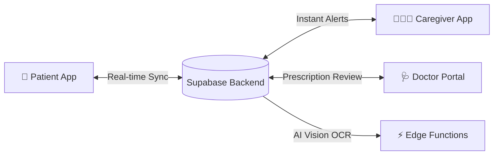
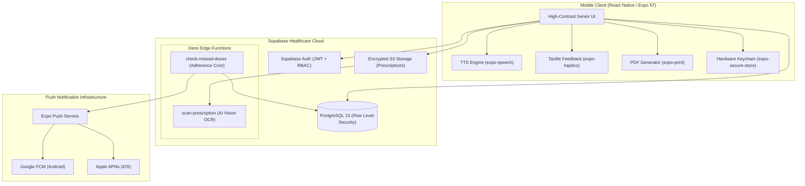

<p align="center">
  
</p>

<h1 align="center">MedSync 💊</h1>

<p align="center">
  <strong>Next-Gen Medication Adherence, AI Prescription OCR Scanner & Caregiver Remote Monitoring Platform</strong>
</p>

<p align="center">
  <em>An accessible, intelligent, and secure mobile health application bridging seniors, caregivers, and licensed physicians to eliminate preventable medication errors and maximize therapy adherence.</em>
</p>

<p align="center">
  <a href="https://github.com/breathtaker-adi/Medsync/actions/workflows/ci.yml">
    
  </a>
  <a href="https://expo.dev">
    
  </a>
  <a href="https://reactnative.dev">
    
  </a>
  <a href="https://supabase.com">
    
  </a>
  <a href="https://www.typescriptlang.org">
    
  </a>
  <a href="https://github.com/breathtaker-adi/Medsync/blob/main/LICENSE">
    
  </a>
  <a href="#-automated-testing--code-quality">
    
  </a>
  <a href="https://github.com/breathtaker-adi/Medsync/pulls">
    
  </a>
</p>

---

## 📑 Table of Contents

- [Overview](#-overview)
- [Why MedSync?](#-why-medsync)
- [Key Features](#-key-features)
  - [👵 Patient & Senior Experience](#-patient--senior-experience)
  - [👨‍👩‍👧 Caregiver Ecosystem](#-caregiver-ecosystem)
  - [🩺 Doctor & Clinical Portal](#-doctor--clinical-portal)
  - [🤖 AI Vision OCR Prescription Scanner](#-ai-vision-ocr-prescription-scanner)
- [System Architecture](#-system-architecture)
- [Tech Stack](#-tech-stack)
- [Security, Privacy & Compliance](#-security-privacy--compliance)
- [Getting Started](#-getting-started)
  - [Prerequisites](#prerequisites)
  - [Quickstart Installation](#quickstart-installation)
  - [Environment Variables](#environment-variables)
- [Automated Testing & Code Quality](#-automated-testing--code-quality)
- [Cloud Build & EAS Deployment](#-cloud-build--eas-deployment)
- [Project Directory Structure](#-project-directory-structure)
- [Contributing](#-contributing)
- [License](#-license)

---

## 🌟 Overview

**MedSync** is an enterprise-grade mobile health (mHealth) application engineered with **React Native (Expo SDK 57)** and **Supabase (PostgreSQL 15 + Edge Functions)**. Designed to tackle the global $300B crisis of medication non-adherence, MedSync unifies three critical healthcare pillars into a synchronized real-time ecosystem:

1. **Patients / Seniors**: Simplified, high-contrast, voice-guided medication reminders with zero friction.
2. **Family Caregivers**: Remote adherence telemetry, streak metrics, and real-time missed-dose emergency alerts.
3. **Doctors / Clinicians**: Prescription validation, dosage regimen management, and official medical credentialing.



---

## 💡 Why MedSync?

Medication non-adherence leads to over **125,000 preventable deaths** and up to **25% of hospital admissions** each year. Existing reminder apps fail seniors because of tiny fonts, convoluted navigation, lack of caregiver accountability, and tedious manual data entry.

MedSync solves this with:
- **Zero-Typing Regimen Onboarding**: Snap a photo of a doctor's handwritten or printed prescription; our AI Vision OCR engine extracts medications, dosages, and schedules in seconds.
- **Senior-First Accessibility (WCAG AAA)**: Oversized touch targets, dynamic font scaling, tactile haptics, and spoken voice directions.
- **Fail-Safe Caregiver Watch**: If a senior misses a dose or forgets their phone, caregivers receive an urgent notification automatically.

---

## ✨ Key Features

### 👵 Patient & Senior Experience
- **Senior-Optimized Interface**: High-contrast color palettes, large typography, and zero confusing nested menus.
- **Text-to-Speech (TTS) Voice Guidance**: Native voice announcements (`expo-speech`) speak aloud exact medication names and instructions (e.g., *"Take 500mg Metformin with a glass of water"*).
- **Haptic Tactile Confirmations**: Multi-stage haptic vibration feedback (`expo-haptics`) confirms actions for users with tremors or visual limitations.
- **One-Tap Actions**: Big, bold `TAKEN`, `SNOOZE (15m)`, and `SKIP` buttons.
- **Adherence Reports & PDF Export**: Generates professional clinical adherence PDF summaries integrated directly into the native Android OS Print Spooler (`expo-print`).

### 👨‍👩‍👧 Caregiver Ecosystem
- **Remote Telemetry Dashboard**: Live insight into family members' medication intake, streak scores, and adherence rates.
- **Automated Missed-Dose Notifications**: Push alerts triggered if a senior fails to acknowledge medication within the safety grace window.
- **Multi-Patient Support**: Caregivers can monitor multiple aging parents or dependents from a single unified view.
- **Secure Pairing**: Connect with patients in seconds using short alphanumeric pairing codes.

### 🩺 Doctor & Clinical Portal
- **Physician Credentialing & Registry Verification**: Robust multi-step verification against state/national medical registries.
- **Prescription Review Queue**: Doctors inspect patient-uploaded prescription images alongside AI-extracted metadata before approving regimens.
- **Patient Directory & Regimen Management**: Directly adjust active dosages, pause medications for lab tests, and track compliance trends.
- **Defense-in-Depth Clinical Security**: Role-based access control guarantees patient confidentiality.

### 🤖 AI Vision OCR Prescription Scanner
- **Computer Vision Extraction**: Edge functions powered by multi-modal AI analyze prescription labels and handwriting.
- **Structured Output**: Converts raw camera captures into structured JSON: medication name, dosage strength, unit, route, frequency, and custom clinical notes.
- **Confidence Scoring & Doctor Sign-Off**: Prevents misread dosages by tagging AI suggestions for patient or physician confirmation.

---

## 🏛 System Architecture

MedSync utilizes a reactive, offline-first client architecture powered by Supabase Realtime and Edge Computing:



---

## 🛠 Tech Stack

| Layer | Technology | Version | Purpose |
| :--- | :--- | :--- | :--- |
| **Framework** | [React Native](https://reactnative.dev) | `0.86.3` | Universal native cross-platform core |
| **App Runtime** | [Expo SDK](https://expo.dev) | `57.0.30` | Modern managed native runtime & build pipeline |
| **Navigation** | [Expo Router](https://docs.expo.dev/router/introduction/) | `57.0.28` | File-based typed routing & deep linking |
| **Database & Auth** | [Supabase](https://supabase.com) | `v2.112.4` | PostgreSQL with Row Level Security & Auth |
| **Edge Compute** | [Deno / Supabase Functions](https://supabase.com/docs/guides/functions) | `Latest` | Serverless AI OCR & Missed-Dose cron triggers |
| **Language** | [TypeScript](https://www.typescriptlang.org) | `6.0.3` | End-to-end static typing & strict null checks |
| **State & Storage**| [AsyncStorage](https://react-native-async-storage.github.io/async-storage/) & [SecureStore](https://docs.expo.dev/versions/latest/sdk/securestore/) | `2.2.0` | Secure hardware-backed keychain & offline cache |
| **Voice & Accessibility** | [Expo Speech](https://docs.expo.dev/versions/latest/sdk/speech/) & [Expo Haptics](https://docs.expo.dev/versions/latest/sdk/haptics/) | `57.0.3` | Accessible spoken audio directions & tactile confirmation |
| **Reports** | [Expo Print](https://docs.expo.dev/versions/latest/sdk/print/) | `57.0.2` | Native PDF generation & Android Print Spooler |
| **CI/CD** | [GitHub Actions](https://github.com/features/actions) & [EAS Build](https://expo.dev/eas) | `v4` | Automated typechecking, security testing, cloud builds |

---

## 🔒 Security, Privacy & Compliance

MedSync adheres to defense-in-depth principles and core HIPAA / GDPR data privacy guidelines:

> [!IMPORTANT]
> **Strict Row Level Security (RLS)**: Every single table in the PostgreSQL database enforces isolated RLS policies. Patients can only query their own records, caregivers can only inspect linked dependents, and doctors can only access patients under active clinical care.

- **Impenetrable Privilege Safeguards**: Database triggers (`protect_profile_fields`) mathematically prevent clients from escalating their own privileges (such as self-granting `is_verified_doctor` status).
- **Hardware-Backed Cryptographic Storage**: Sensitive session tokens and encryption keys are stored inside device hardware keystores via `expo-secure-store`.
- **Zero Hardcoded Secrets**: All cloud API keys and project configurations are dynamically injected via EAS secret variables (`GOOGLE_SERVICES_JSON`, Supabase anon keys).
- **Sanitized Audit Logging**: Health reports and edge functions scrub sensitive medical telemetry to prevent PII/PHI leakage.

---

## 🚀 Getting Started

### Prerequisites

Ensure you have the following installed:
- [Node.js](https://nodejs.org) `v20.x` or higher
- [npm](https://www.npmjs.com) or `yarn` / `pnpm`
- [Expo Go](https://expo.dev/go) on your physical device, or an Android/iOS emulator
- [Git](https://git-scm.com)

### Quickstart Installation

1. **Clone the repository:**
   ```bash
   git clone https://github.com/breathtaker-adi/Medsync.git
   cd Medsync
   ```

2. **Install project dependencies:**
   ```bash
   npm install
   ```

3. **Configure Environment Variables:**
   ```bash
   cp .env.example .env
   ```
   Fill in your Supabase credentials:
   ```env
   EXPO_PUBLIC_SUPABASE_URL=https://your-project-id.supabase.co
   EXPO_PUBLIC_SUPABASE_ANON_KEY=eyJhbGciOiJIUzI1NiIsInR5cCI6IkpX...
   EXPO_PUBLIC_EAS_PROJECT_ID=your-eas-project-id
   ```

4. **Launch the development server:**
   ```bash
   npx expo start
   ```
   - Press <kbd>a</kbd> for Android Emulator
   - Press <kbd>i</kbd> for iOS Simulator
   - Press <kbd>w</kbd> for Web Browser
   - Scan the QR code using the **Expo Go** app on your physical mobile device.

---

## 🧪 Automated Testing & Code Quality

MedSync enforces continuous quality checks on every push and pull request via GitHub Actions:

```bash
# Run the complete automated test suite (67 unit & security tests)
npm test

# Run static TypeScript compiler checks
npx tsc --noEmit

# Run Expo Doctor dependency and health audit
npx expo-doctor
```

```
✔ 67 passing (0 failed)
✔ All RLS policy integrity tests passed
✔ All profile escalation boundary tests passed
✔ TypeScript clean (0 errors)
```

---

## 📦 Cloud Build & EAS Deployment

MedSync is configured for automated cloud builds via [Expo Application Services (EAS)](https://expo.dev/eas):

```bash
# Generate Android Preview APK (direct install on any device)
eas build --profile preview --platform android

# Generate Production Android AAB (Google Play Store release)
eas build --profile production --platform android

# Submit directly to Google Play Store
eas submit --platform android
```

> [!NOTE]
> `google-services.json` is strictly protected and never committed to Git. Cloud builds inject the credential securely using EAS file environment variables:
> ```bash
> eas env:set --environment production --name GOOGLE_SERVICES_JSON --type file --value ./google-services.json --visibility secret
> ```

---

## 📂 Project Directory Structure

```text
medsync-app/
├── .github/
│   └── workflows/
│       └── ci.yml               # Automated CI (Typecheck + 67 Security Tests)
├── assets/
│   ├── images/                  # High-res logos, brand assets, app icons
│   └── fonts/                   # Accessible custom typography
├── src/
│   ├── app/
│   │   ├── (tabs)/              # Primary Tab Navigators
│   │   │   ├── patient-dashboard.tsx    # High-contrast senior dashboard
│   │   │   ├── caregiver-dashboard.tsx  # Remote family telemetry & streak tracker
│   │   │   └── uploads.tsx              # Prescription scanner upload hub
│   │   ├── doctor-verification.tsx      # Official medical registry credentialing
│   │   ├── review-details.tsx           # Clinical prescription approval queue
│   │   ├── patient-directory.tsx        # Doctor patient management directory
│   │   ├── settings.tsx                 # Adherence PDF generation & health reports
│   │   └── login.tsx                    # Accessible multi-role authentication
│   └── components/              # SeniorButton, MedSyncLogo, VoicePlayer, etc.
├── supabase/
│   ├── functions/
│   │   ├── scan-prescription/   # AI Vision OCR extraction engine
│   │   └── check-missed-doses/  # Scheduled adherence checker cron
│   └── migrations/              # RLS policies, schemas, and defense triggers
├── tests/                       # 67 Automated unit, security, and RLS tests
├── app.config.js                # Dynamic Expo configuration & EAS secret loader
├── eas.json                     # EAS Build profiles (preview, production)
└── package.json                 # Dependency manifest
```

---

## 🤝 Contributing

Contributions to MedSync are warmly welcomed! Whether you are reporting a bug, improving documentation, or proposing new accessibility features:

1. Fork the Project (`https://github.com/breathtaker-adi/Medsync/fork`)
2. Create your Feature Branch (`git checkout -b feature/AmazingAccessibilityFeature`)
3. Commit your Changes (`git commit -m 'feat: add high-contrast large font toggle'`)
4. Verify Tests Pass (`npm test && npx tsc --noEmit`)
5. Push to the Branch (`git push origin feature/AmazingAccessibilityFeature`)
6. Open a Pull Request

Please read our [Contributing Guidelines](CONTRIBUTING.md) and adhere to our [Code of Conduct](CODE_OF_CONDUCT.md).

---

## 📄 License

Distributed under the **MIT License**. See [`LICENSE`](LICENSE) for complete details.

---

<p align="center">
  Built with ❤️ for accessible healthcare by <a href="https://github.com/breathtaker-adi"><strong>breathtaker-adi</strong></a> & contributors.
</p>
<p align="center">
  <a href="#medsync-">Back to Top ↑</a>
</p>
