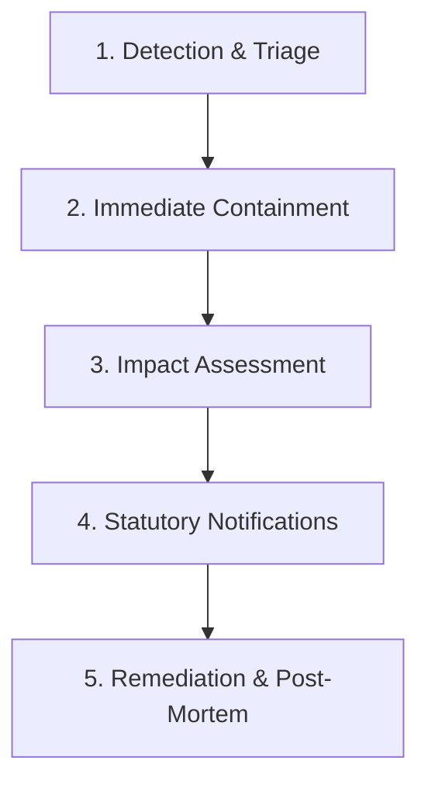

# MedSync Personal Data Breach Management & Incident Response Policy (BREACH.md)

**Statutory Alignment:** Section 8(6) of India's Digital Personal Data
Protection (DPDP) Act, 2023 and CERT-In Cyber Security Directions.\
**Designated Data Fiduciary:** Aditya Kumawat (Lead Open-Source Maintainer,
Jodhpur, Rajasthan, India)\
**Emergency Incident Contact:** `adityak231105@gmail.com`

---

## 1. Purpose & Scope

This incident response charter establishes protocols for detecting, containing,
investigating, and reporting personal data breaches involving patient
prescription records, caregiver linkages, adherence logs, or authentication
tokens managed by MedSync.

A **Personal Data Breach** is defined under the DPDP Act 2023 as any
unauthorized processing of personal data or accidental disclosure, acquisition,
sharing, use, alteration, destruction of or loss of access to personal data,
that compromises the confidentiality, integrity or availability of personal
data.

---

## 2. Incident Response Phases

### Phase 1: Detection & Triage (Hour 0 to 6)

- **Monitoring Sources**: Automated Supabase security logs, GitHub Security
  Advisories, Google Cloud audit logs, or direct researcher reports.
- **Triage Criteria**:
  - **P1 (Critical)**: Unauthorized mass export, RLS bypass exposing multi-user
    records, or compromised service-role key.
  - **P2 (High)**: Individual unauthorized access to a single patient's
    prescription or pairing link.
  - **P3 (Medium)**: Unauthenticated denial-of-service against edge functions
    without data exfiltration.

### Phase 2: Containment & Isolation (Hour 6 to 12)

- Immediately revoke compromised API keys or session tokens via Supabase
  dashboard.
- Rotate backend service-role and AI provider credentials.
- In severe database vulnerability scenarios, temporarily enable maintenance
  mode on the PostgREST API to prevent exfiltration while patching RLS policies.

### Phase 3: Impact Assessment (Hour 12 to 24)

- Audit database access logs to determine:
  - Exact data principals (patients/caregivers) affected.
  - Categories of personal data accessed (prescription names, dosages, phone
    numbers).
  - Whether data was encrypted or exposed in plaintext.

### Phase 4: Statutory Notifications (Hour 24 to 72)

In accordance with Section 8(6) of the DPDP Act 2023:

1. **Notification to the Data Protection Board of India (DPBI)**:
   - Nature of the incident, affected systems, estimated number of affected
     principals.
   - Immediate containment actions taken and planned remediation.
2. **Notification to Affected Data Principals (Patients & Caregivers)**:
   - Direct clear notification dispatched via in-app alert and registered email.
   - Description of the breach, potential safety/privacy risks, and recommended
     actions (e.g., password reset, reviewing linked caregivers).
3. **CERT-In Reporting**: Mandated 6-hour cybersecurity incident reporting for
   qualified critical cybersecurity incidents.

### Phase 5: Remediation & Post-Mortem

- Deploy permanent code/migration patch with regression test in `tests/`.
- Publish public transparency report in GitHub Security Advisories detailing
  root cause, remediation, and zero-trust enhancements.

---

## 3. Contact & Reporting

To report an active security incident or data breach:

- **Email**: `adityak231105@gmail.com`
- **Private Advisory**:
  [github.com/breathtaker-adi/Medsync/security/advisories](https://github.com/breathtaker-adi/Medsync/security/advisories)
